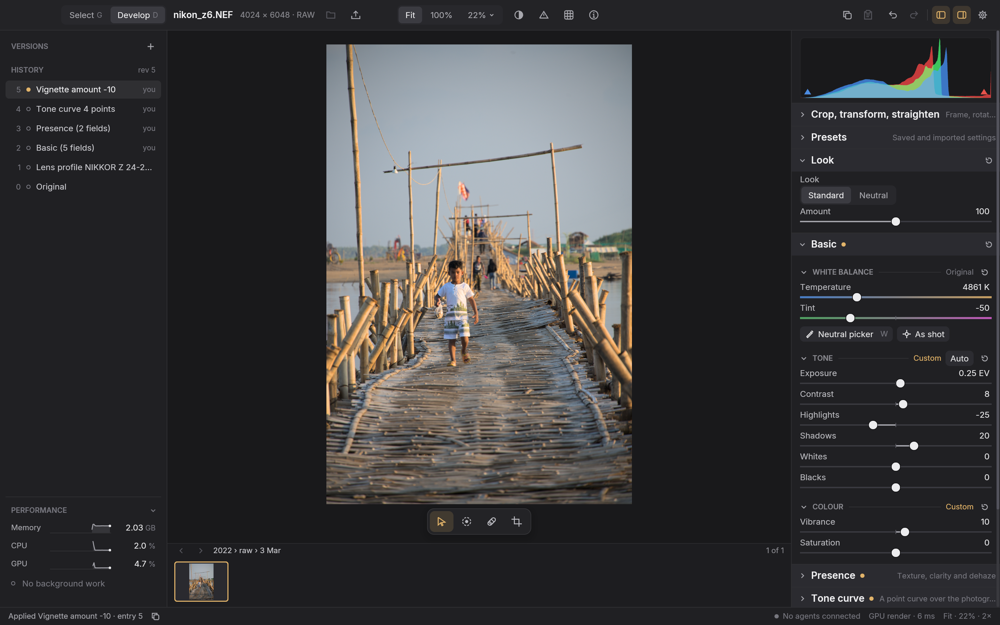
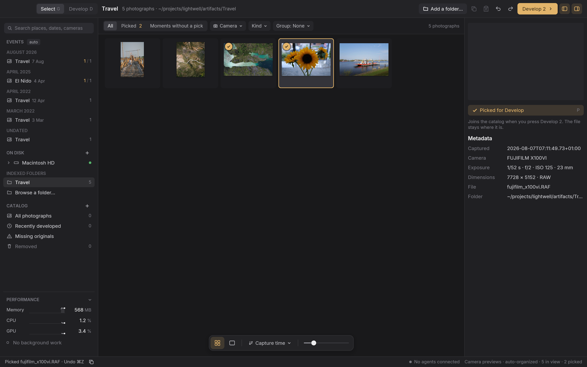
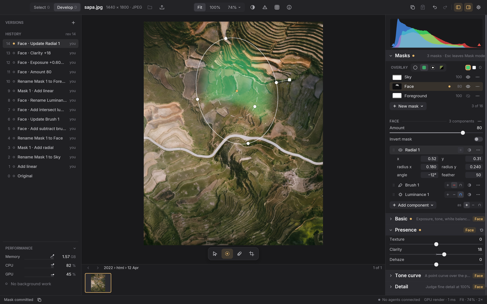
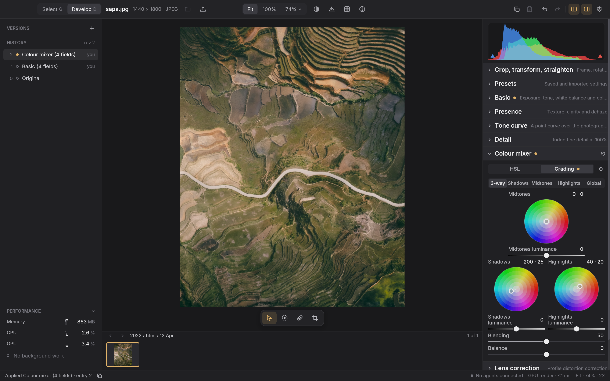
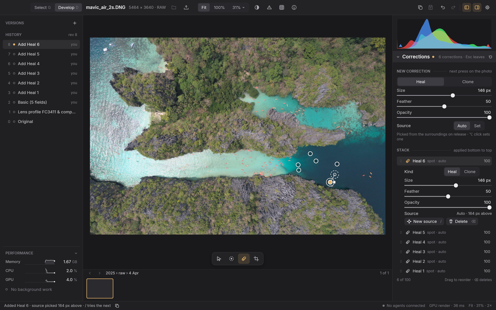

<h1 align="center">Luxforge</h1>

<p align="center">
  A fast, non-destructive photo editor for macOS, Windows and Linux.<br>
  Modular, hackable, programmable and open.
</p>

<p align="center">
  <a href="LICENSE"></a>
  
  
</p>

---

## Getting started

Maintainers can [run `cargo xtask release v0.1` from clean, synchronized `main`](docs/engineering/releases.md) to build macOS and Linux downloads. The workflow automatically publishes pre-release build candidates; no qualified public download exists yet.

You'll need Rust (the toolchain is pinned) and a few platform prerequisites, listed in [development](docs/engineering/development.md). Then:

```sh
git clone https://github.com/Willyham/luxforge.git
cd luxforge
cargo xtask develop --open fixtures/s0/orientation-6.jpg
```

That builds an optimized editor and opens a sample photo. Use `--catalog path/to/catalog.sqlite` to keep your edits somewhere specific, or `--open` any JPEG or supported RAW file of your own. Luxforge only records a reference to the original and never copies or changes it.

The [user guide](docs/user-guide.md) covers the workspace, keyboard shortcuts and every tool. Initial [v0.1 distribution preparation](docs/design/release-v0.1.md) is planned; there is no published app download yet.

## Why Luxforge

Luxforge is a free, open-source, cross-platform photo editor. Its goal: meet or exceed the quality and experience of Adobe Lightroom—a benchmark that DHH once called "the last holdout" keeping him on macOS.

- **"The last holdout."** Luxforge aims for parity with leading commercial tools, so you never have to compromise on quality or workflow.
- **"Anything you can click, a program can do."** Every slider, crop handle, and action in the interface goes through the same command service as the JSON API. Scripts, plugins, and AI agents interact with the app just like a user does: if they warm up a photo, their edits appear in the same non-destructive history, clearly attributed.

## The pillars

These are the core principles that development follows. 

1. **Originals are sacred.** Source files are never modified. Edits are ordered layers in a recipe with immutable history. Incompatible data is refused, never quietly discarded.
2. **Everything is programmable.** Every operation has a discoverable, schema-described equivalent through the same command service. A GUI gesture is never the only way in, and UI/API parity is tested, not assumed.
3. **Fast, bounded and honest.** Responsiveness, bounded memory and image correctness are architectural requirements, measured on photo-sized inputs. The GPU is the renderer of record, and its correctness is a declared tolerance against the whole-frame CPU reference, measured on the corpus.
4. **Small core, deliberate extension points.** The core owns transactions, history and shared invariants. Tools own their own validation, controls and processing.
5. **Open source, Mac first.** GPL-3.0-or-later project code and open-source dependencies, targeting Apple silicon Macs first while keeping Windows and Linux portable.
6. **Prove it.** Claims about behavior come with evidence: exact-buffer tests for the reference renderer, reference-buffer tests within the declared tolerance for the GPU, correlated state, logs and captures for UI, and recorded measurements with their scope.
7. **Beautiful defaults, familiar feel.** A small, focused workspace that feels familiar if you've used Lightroom's Library and Develop.

## What it does today

Luxforge is pre-release. Everything is v0, formats can change between builds, and there is no qualified public download yet. With that said, a lot already works and has been checked on Apple silicon Macs.

<p align="center">
  
  <br>
  <sub>The Develop workspace editing a RAW file, captured from the running app.</sub>
</p>

### Browse, pick, develop

- **The Select workspace** browses disks and folders without importing anything. Photographs are grouped automatically into events and moments by date, place and camera. Filter and search them, look closely in the loupe, then pick the keepers and develop them into the catalog. Originals stay where they are and are never copied or changed.
- **The catalog** keeps folders, collections, recently developed photographs and a Removed view. If you move or rename originals, **Missing originals** and **Locate** find them again.
- **HDR merges** of RAW brackets and **panorama merges** of RAW or JPEG frames start from a selection. You get a merge preview first, and the result is an editable photograph stacked with its originals. Both are early: they've been checked on synthetic frames, and natural-scene quality hasn't been qualified yet.

### Develop

- **Non-destructive editing** with ordered layers, persistent history, undo and redo, append-only restore, and named versions. Nothing in history is ever deleted, and repeated drags on one control collapse into a single entry.
- **RAW editing** from sensor data, with RawSpeed unpacking, a Standard look for new RAW photographs and automatic lens profiles. The camera catalog covers **259 camera and phone identities and 316 recording modes**, regression-tested against a corpus of authentic files. [Camera coverage](docs/design/raw-camera-profiles.md) records the exact scope.
- **Basic adjustments**: white balance with a neutral picker and As shot, exposure, contrast, highlights, shadows, whites, blacks, vibrance and saturation, plus **Auto tone** (Cmd+U).
- **Tone curve**, **Presence** (texture, clarity, dehaze), **Detail** (capture sharpening and noise reduction) and a **vignette**.
- **Colour mixer** with hue, saturation and luminance for eight ranges, and **colour grading** wheels for shadows, midtones, highlights and global.
- **Crop, transform and straighten**, with 90° rotation, mirror and flip, plus **lens correction** from Lensfun profiles and manual **perspective** correction.
- **Local masking**: linear and radial gradients, feathered brushes with erase and colour constraints, and luminance and colour range selections. Combine components with Add, Subtract and Intersect, invert them or set the mask's amount, then apply Basic, Tone curve, Detail, colour mixer and Presence adjustments locally. Live coverage overlays and canvas handles show what you're adjusting.
- **Corrections**: Clone and Heal, as spots or brush strokes, with a source picked automatically or set by hand.
- **Presets**, including import of Lightroom Classic XMP and `.lrtemplate` presets with a report of anything that couldn't be carried over, and **copy and paste settings** across one or many photographs.
- **JPEG export** from JPEG or RAW originals at the edit's output size, with an embedded sRGB profile. Metadata is stripped by default or kept for supported EXIF fields. Exports never replace an existing file or touch the original.

### See what you're doing

- **GPU rendering** at every zoom. The GPU draws motion, the finished picture, the histogram and exports, all held within a declared tolerance of an independent whole-frame CPU reference.
- **An RGB histogram** with clipping overlays, **Before/After** comparison with a draggable divider, **image information** (camera, lens and exposure), and a **minimap** at high zoom.
- **A command palette**, and **Copy as JSON request** on any control.
- **Live counters** for memory, CPU and GPU, alongside background jobs.
- **Themes**, including six bundled Omarchy themes and import of your own, plus preferences for the defaults that matter.

### Built for scripts and agents

- **The JSON API** covers every operation, and the **`luxforge-ctl`** command line drives the photograph open in the running editor (see [Scripting it](#scripting-it)).
- **Live agents**: if a script commits an edit while you're mid-drag, Luxforge keeps your draft and asks whether to discard it or reapply it on top. Every edit is attributed in history.

<table>
  <tr>
    <td width="50%"><br><sub><b>Select</b>: browse a folder, pick photographs and develop them into the catalog.</sub></td>
    <td width="50%"><br><sub><b>Masking</b>: a radial gradient, a subtracting brush and a luminance intersection shape a local adjustment.</sub></td>
  </tr>
  <tr>
    <td width="50%"><br><sub><b>Colour grading</b>: shadow, midtone and highlight wheels in the colour mixer.</sub></td>
    <td width="50%"><br><sub><b>Corrections</b>: Heal spots, each with an automatic source, removing kayaks from a drone RAW.</sub></td>
  </tr>
</table>

### On the way

Generative Remove and Replace on local models are in progress behind an experiment flag. Automatic updates are built but not yet live. An MCP adapter, Lightroom catalog import and broader Windows and Linux verification are planned. [Feature status](docs/features.md) has the full, current picture, including what hasn't been verified yet, and the [roadmap](docs/plan.md) has what comes next.

## Scripting it

Every operation in the editor is a JSON request. You can talk to the running app, or start a headless process that holds the same catalog and send it one request per line. `cargo xtask build --release` builds it with the editor, and `cargo build --release -p luxforge-cli` builds it alone, without the GUI stack:

```sh
target/release/luxforge-json --catalog path/to/catalog.sqlite
```

```json
{"id":"schema","method":"schema.list","params":{}}
{"id":"expose","method":"edit.set-basic","params":{"asset_id":"asset-…","mutation":{"expected_revision":5,"request_id":"expose-1","actor":"my-script"},"exposure":0.5}}
```

`schema.list` and `module.list` describe every method with its parameters, ranges and defaults, so a client can discover what's possible instead of hard-coding it. Edits carry an expected revision, so stale requests are refused rather than silently applied, and a retried request with the same `request_id` is never applied twice. In the app, right-click any control and choose **Copy as JSON request** to get the exact call it makes.

To drive the photograph open in the running editor from a shell or an agent, use `luxforge-ctl`, built alongside it. It finds the running session, fills in the revision and request identity for you, and its edits appear in history as its own:

```sh
target/release/luxforge-ctl status
target/release/luxforge-ctl call edit.set-basic --asset asset-… --params '{"exposure": 0.5}'
target/release/luxforge-ctl call edit.auto-tone --asset asset-…
```

## How it's built

Luxforge is written in Rust with a deliberately small core. The core owns the catalog, recipes, history and undo, rendering and the command service. Each tool (Basic, the colour mixer, crop and the rest) is a module that declares its parameters, controls and processing. The desktop builds its panels from those declarations, and the API generates `edit.*` methods from the same ones, so the two can't drift apart.

| Crate | What it holds |
| --- | --- |
| `luxforge-core` | Images, recipes, rendering, the SQLite catalog and history, preview scheduling, the JSON API |
| `luxforge-net` | The host's checked network transport and secure secret store, kept outside the core |
| `luxforge-gpu` | The shared wgpu executor: shader cache, uploads, render passes, histogram reduction and tile readback |
| `luxforge-gpu-types` | Pure GPU formats and pass shapes shared by the core's planning and the device; depends on `std` only |
| `luxforge-jpeg` | The one JPEG codec (libjpeg-turbo) for reading originals and writing exports, with the JPEG container around it; depends on no workspace crate |
| `luxforge-process` | CPU, memory and GPU counters for the editor process |
| `luxforge-raw` | RAW decoding and development |
| `luxforge-onnx` | Local model inference through ONNX Runtime, with Core ML on macOS |
| `luxforge-diffusion` | The local generative runtime (stable-diffusion.cpp and ggml, built from pinned sources) |
| `luxforge-watch` | Folder and volume change notifications, and the mounted file systems the catalog's index reads |
| `luxforge-input` | Native input the window framework omits, such as trackpad magnification |
| `luxforge-update`, `luxforge-sparkle`, `luxforge-install` | Signed update feeds, the macOS Sparkle bridge and the Linux updater, and moving the app into Applications |
| `luxforge-ui` | The widget library (built on [iced](https://iced.rs)), with no dependency on the core |
| `luxforge-app` | The desktop app |
| `luxforge-cli` | The headless `luxforge-json` and live-session `luxforge-ctl` binaries, and where the application keeps its files; builds without the GUI stack |
| `luxforge-evidence` | The evidence script's step types, shared by the desktop and `xtask` so a scripted run and a hand-written one read the same shape |
| `luxforge-reference` | Independent f64 references (colour, mask, mixer, Presence, range, tone, vignette, white balance) that production is tested against; depends on no workspace crate |
| `luxforge-testbase` | The one gate and hang-bounded wait every test orders its steps by; depends on no workspace crate, never shipped |
| `luxforge-test-macros` | The `#[slow]` test attribute the quick tier leaves out; never shipped |
| `luxforge-testkit` | Fixtures shared by the tests and `xtask`, such as the loopback test server; never shipped |
| `xtask` | Every build, check, evidence and packaging command |

The editor tells you what it's doing. The Performance section shows memory, CPU and GPU use alongside whatever is running in the background, and the same numbers are available to any client through `resources.read` and `activity.list`.

More detail is in the [architecture](docs/design/architecture.md) and [tool module](docs/design/modules-and-api.md) docs.

## Platforms

macOS on Apple silicon is the primary target and the only platform with native GPU verification so far. On Linux, CI builds and packages for x86-64 and runs the headless checks with no graphics adapter; its rendered journeys through the software Vulkan adapter await a passing hosted run. Windows CI is disabled, and Windows support will come later. Native Windows and Linux desktop checks remain open. See [platforms](docs/engineering/platforms.md).

## Contributing

Luxforge is developed in the open by a human maintainer working alongside coding agents, and the docs are written for both. Start with [AGENTS.md](AGENTS.md) for the pillars and working rules, then [CONTRIBUTING.md](CONTRIBUTING.md) for the layout and checks. Before handing off a change:

```sh
cargo xtask verify --tier quick --output artifacts/my-change-quick
```

Useful reading:

- **Product:** [roadmap](docs/plan.md), [decisions](docs/decisions.md), [feature status](docs/features.md), [user guide](docs/user-guide.md)
- **Design:** [architecture](docs/design/architecture.md), [Develop workspace](docs/design/develop-workspace.md), [versions and lineage](docs/design/versions-and-lineage.md), [tool modules](docs/design/modules-and-api.md)
- **Specs:** [edit history](docs/specs/edit-history.md), [crop and export](docs/specs/single-image.md), [source recovery](docs/specs/source-recovery.md), [performance](docs/specs/performance.md)
- **Engineering:** [development](docs/engineering/development.md), [performance rules](docs/engineering/performance-rules.md), [dependencies](docs/engineering/dependencies.md)
- **Research:** [stack options](docs/research/technical-options.md), [Lightroom Classic](docs/research/lightroom/README.md), [darktable](docs/research/darktable/README.md)
- **Task plans:** [tasks](tasks/README.md)

## License

Luxforge is free software under the [GNU General Public License v3.0 or later](LICENSE). Third-party components keep their own licenses. A manual review of licenses, native dependencies and assets has been deferred and is not complete.
