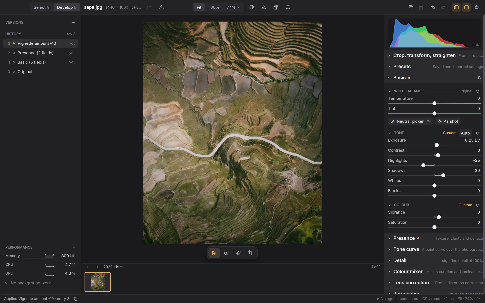
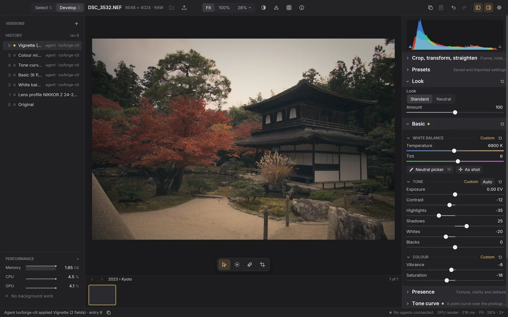
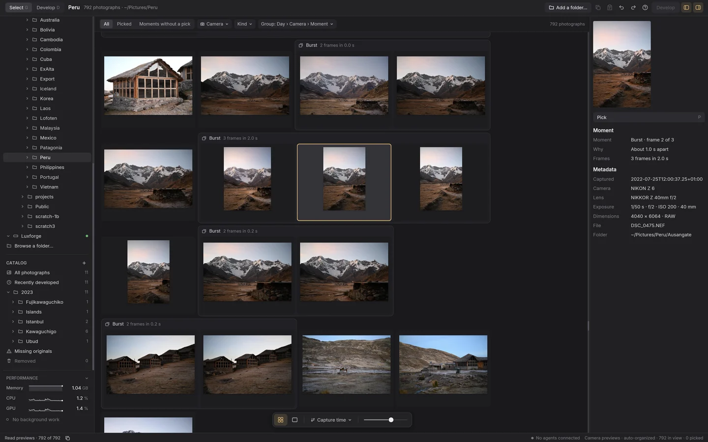
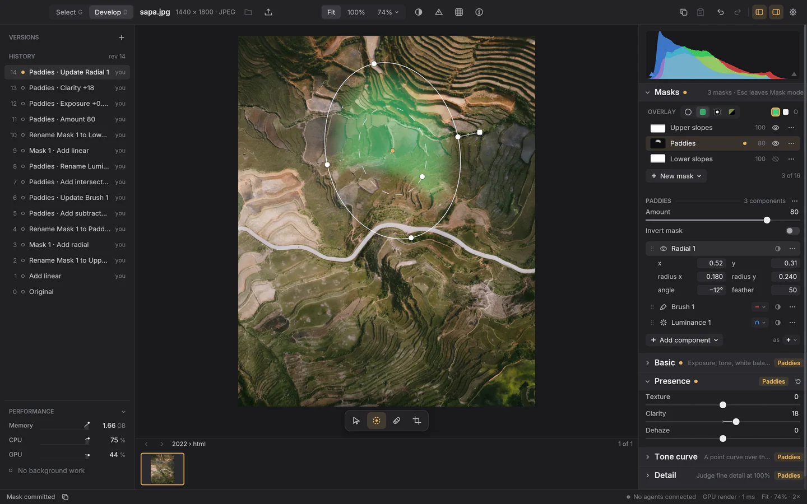
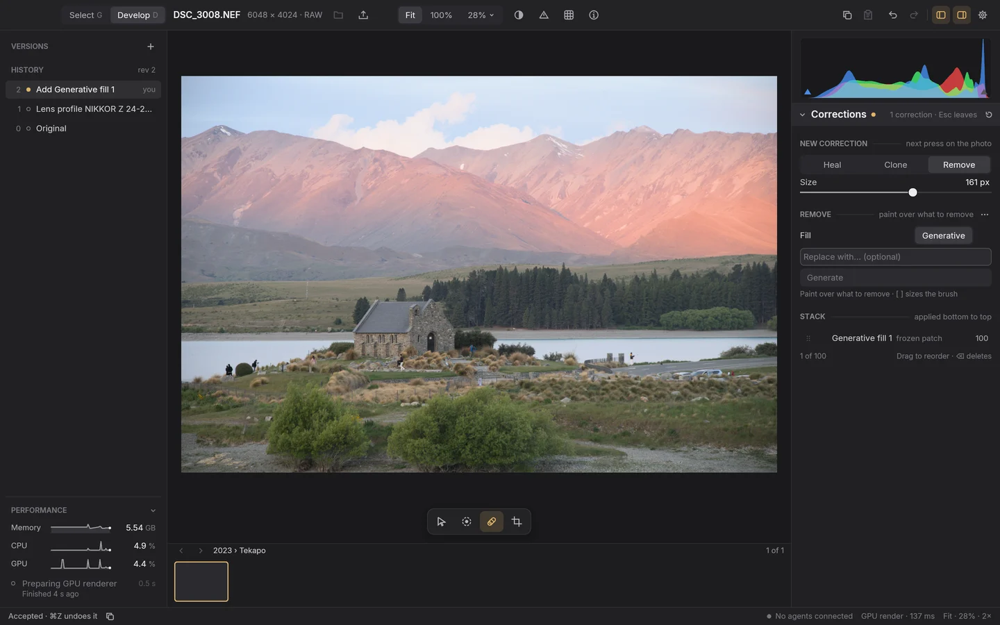
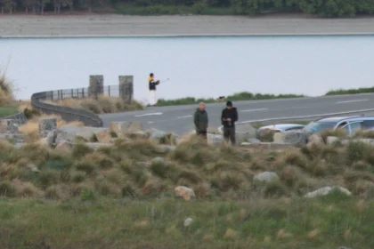

<p align="center">
  
</p>

<h3 align="center">A fast, open-source, cross-platform photo editor.</h3>

<p align="center">
  Written in Rust and rendered on the GPU. Free, open source and non-destructive,<br>
  for macOS and Linux now and Windows later.
</p>

<p align="center">
  <a href="https://github.com/Willyham/luxforge/releases/tag/v0.1.0"></a>
  <a href="LICENSE"></a>
  <a href="https://luxforge.app"></a>
  
</p>

<p align="center">
  <a href="#get-luxforge"><b>Download</b></a> ·
  <a href="https://luxforge.app">Website</a> ·
  <a href="docs/user-guide.md">User guide</a> ·
  <a href="docs/features.md">Feature status</a> ·
  <a href="#contributing">Contributing</a>
</p>

<p align="center">
  
  <br>
  <sub>Luxforge 0.1.0's Develop workspace, captured from the running app.</sub>
</p>

---

Luxforge aims to meet or exceed the quality and experience of Adobe Lightroom, a benchmark DHH once called "the last holdout" keeping him on macOS. Every slider, brush and crop is a request through one API, so AI agents and scripts can edit alongside you. Each tool is a module on a small core.

Develop will feel familiar if you know Lightroom. Underneath it is new: a small, fast core that keeps every edit as data and never touches the original. Every edit is kept in the history, so you can step back to any point or save it as a named version, and the status bar says what just happened and what drew the picture on screen.

## Get Luxforge

**[Luxforge 0.1.0](https://github.com/Willyham/luxforge/releases/tag/v0.1.0) is the first preview.** It is pre-release software, so its catalog format can change between versions; a version that can't read your catalog says so and leaves it as it is. It never writes to your originals.

| Platform | Download | Install |
| --- | --- | --- |
| **macOS**, Apple silicon, macOS 14 or later | [Disk image](https://github.com/Willyham/luxforge/releases/download/v0.1.0/luxforge-0.1.0-macos-arm64.dmg) (65 MB) or [ZIP](https://github.com/Willyham/luxforge/releases/download/v0.1.0/luxforge-0.1.0-macos-arm64.zip) | Signed and notarized. Open it and drag Luxforge onto Applications. |
| **Linux**, x86-64, built on Ubuntu 24.04 | [Tarball](https://github.com/Willyham/luxforge/releases/download/v0.1.0/luxforge-0.1.0-linux-x86_64.tar.gz) (71 MB) | Extract it and run `Luxforge/luxforge`; `./Luxforge/desktop-integration.sh install` adds it to your launcher. It needs a Vulkan driver and an XDG desktop portal, and `INSTALL.txt` lists the rest. Other distributions may work, but they are not tested. |

[Checksums](https://github.com/Willyham/luxforge/releases/download/v0.1.0/SHA256SUMS) · [complete source](https://github.com/Willyham/luxforge/releases/download/v0.1.0/luxforge-0.1.0-source.tar.gz) · [every release](https://github.com/Willyham/luxforge/releases)

### Or build it from source

You'll need Rust (the toolchain is pinned) and the platform prerequisites in the [development guide](docs/engineering/development.md). Then:

```sh
git clone https://github.com/Willyham/luxforge.git
cd luxforge
cargo xtask develop --open fixtures/s0/orientation-6.jpg
```

That builds an optimized editor and opens a sample photo. Use `--catalog path/to/catalog.sqlite` to keep your edits somewhere specific, or point `--open` at any JPEG or supported RAW of your own. Luxforge only records a reference to the original and never copies or changes it.

The [user guide](docs/user-guide.md) covers the workspace, keyboard shortcuts and every tool. Maintainers cut releases with [`cargo xtask release`](docs/engineering/releases.md).

## Fast where you feel it

Luxforge opens before you've finished clicking, sorts a year of photographs while you watch, keeps up with your hand on every slider, and goes quiet when you stop.

| | |
| ---: | --- |
| **9 ms** | From slider to screen. Each move of a slider, drawn on a 20 MP RAW in the next frame of a 120 Hz display. |
| **40 ms** | To flick to the next frame. Full screen, as fast as you press the arrow key. |
| **0.3 s** | To open. From launch to a window ready to work. |
| **1 s** | To sort a year. 3,507 photographs, 150 GB of RAW and JPEG, sorted into days, cameras, bursts and brackets. |
| **25 s** | To preview all of it. Every one of those photographs, ready to look through. |
| **< 1%** | CPU at rest. When you stop, Luxforge stops: no busy loops, no fans, no drained battery. |

<sub>Rounded from measurements of 0.1.0 on a MacBook Pro with an M4 Pro, browsing the owner's own 2023 folder in place. The [performance spec](docs/specs/performance.md) has the budgets and how they're measured. Luxforge shows its own memory, CPU and GPU use as it works, and any script can read them too.</sub>

## API driven and agent friendly

Everything you can do in Luxforge, a program can do too. Every slider, mask, correction, pick and export is a request through one documented API, so a script or an AI agent works on your photographs the way you do, in the same history, where you can see and undo it.

- **Every action, a request.** The API covers developing, masks, corrections, picking, merging, exporting and history. Right-click any control and choose **Copy as JSON request** to get the exact call it makes.
- **Self-describing.** `schema.list` explains every method and parameter in plain words, with ranges and defaults, so an agent knows what Highlights −35 will do before it sends it.
- **Attributed and undoable.** An agent's edits land in the photograph's history beside yours, each labelled with who made it.
- **Safe beside you.** Each edit names the revision it expects. If you changed the photograph first, it's refused rather than applied on top, and a slider you're still dragging is kept.

> **Hey Claude, make the photo I have open in Luxforge look vintage.**
>
> ```sh
> $ luxforge-ctl call recipe.describe --params '{"asset_id":"asset-effb…"}'
> $ luxforge-ctl call edit.set-raw --asset asset-effb… --params '{"temperature":6900,"tint":6}'
> $ luxforge-ctl call edit.set-basic --asset asset-effb… --params '{"contrast":-12,"highlights":-35,"shadows":25,"whites":-20,"saturation":-18,"vibrance":-8}'
> $ luxforge-ctl call edit.set-curve --asset asset-effb… --params '{"luminance":[[0,0.09],[0.25,0.28],[0.75,0.75],[1,0.93]]}'
> $ luxforge-ctl call edit.set-mixer --asset asset-effb… --params '{"grade-shadows-hue":195,"grade-shadows-saturation":18,"grade-highlights-hue":42,"grade-highlights-saturation":24,"green-saturation":-30,"blue-saturation":-25,…}'
> $ luxforge-ctl call edit.set-vignette --asset asset-effb… --params '{"amount":-22,"feather":70}'
> ```
>
> Done: a warmer white balance, lifted blacks and softened highlights for a faded-film curve, teal shadows under warm highlights, muted greens and blues, and a soft vignette. That's five entries in its history, each one undoable in Luxforge.

<table>
  <tr>
    <td width="50%"><br><sub><b>Before</b></sub></td>
    <td width="50%"><br><sub><b>After</b></sub></td>
  </tr>
  <tr>
    <td colspan="2"><br><sub>The editor afterwards: five history entries, each signed by <code>luxforge-ctl</code>, the sliders showing the agent's values, and the status bar saying who changed what.</sub></td>
  </tr>
</table>

### Scripting it

Every operation in the editor is a JSON request. You can talk to the running app, or start a headless process that holds the same catalog and send it one request per line. `cargo xtask build --release` builds it with the editor, and `cargo build --release -p luxforge-cli` builds it alone, without the GUI stack:

```sh
target/release/luxforge-json --catalog path/to/catalog.sqlite
```

```json
{"id":"schema","method":"schema.list","params":{}}
{"id":"expose","method":"edit.set-basic","params":{"asset_id":"asset-…","mutation":{"expected_revision":5,"request_id":"expose-1","actor":"my-script"},"exposure":0.5}}
```

`schema.list` and `module.list` describe every method with its parameters, ranges and defaults, so a client can discover what's possible instead of hard-coding it. Edits carry an expected revision, so stale requests are refused rather than silently applied, and a retried request with the same `request_id` is never applied twice.

To drive the photograph open in the running editor from a shell or an agent, use `luxforge-ctl`, built alongside it. It finds the running session, fills in the revision and request identity for you, and its edits appear in history as its own:

```sh
target/release/luxforge-ctl status
target/release/luxforge-ctl call edit.set-basic --asset asset-… --params '{"exposure": 0.5}'
target/release/luxforge-ctl call edit.auto-tone --asset asset-…
```

To let an AI agent work in the running editor, connect it to `luxforge-mcp`, a Model Context Protocol server built alongside it. **Settings › Agents** shows the configuration for Claude Code, Claude Desktop, Codex, Cursor and other MCP clients with a Copy button, and lists the agents connected now; `luxforge-mcp config claude-code` prints the same text. An agent's edits land in history under its name, and an agent can never grant consent or permissions ([connecting an agent](docs/user-guide.md#connecting-an-agent)). If a script commits an edit while you're mid-drag, Luxforge keeps your draft and asks whether to discard it or reapply it on top.

## A whole trip of photographs, nothing imported

Point Select at a folder or a camera card and browse it where it is. Luxforge sorts every frame by day, camera and moment as it reads them: bursts gathered into one choice, exposure brackets and panoramas found and ready to merge, RAW and JPEG pairs kept together. Pick the keepers, and only those come into the catalog.

<p align="center">
  
</p>

- **Select** reads a folder where it sits, filters and searches it, and shows each frame in the loupe. Info says why frames belong together: a burst's frame number and spacing, beside the camera, lens and exposure. P picks a keeper; Develop takes the picks into the catalog. Originals are never copied or changed.
- **The catalog** keeps folders, collections, recently developed photographs and a Removed view. If you move or rename originals, **Missing originals** and **Locate** find them again.
- **HDR merges** of RAW brackets and **panorama merges** of RAW or JPEG frames start from a selection. You get a merge preview first, and the result is an editable photograph stacked with its originals. Both are early: they've been checked on synthetic frames, and natural-scene quality hasn't been qualified yet.

## Change one part of the picture, exactly

Masks reach every part of Develop: Basic, the Tone curve, Detail, the colour mixer and Presence can each work through one. Draw gradients, paint with a brush, or pick a colour or a band of tones from the photograph, then combine them. Every mask is numbers in the recipe rather than pixels, so it stays sharp at any size and can be changed at any time.

<p align="center">
  
</p>

- Up to sixteen masks on a photograph, each named, with its own amount and invert.
- **Linear and radial gradients** with feather, angle and handles you drag on the photograph.
- **A brush** with size, feather, flow and erase, which can keep to one colour as it paints.
- **Colour and luminance ranges**, picked with an eyedropper from the photograph itself (an experiment in 0.1.0).
- **Add, subtract and intersect** any of them. Here, Paddies is a radial gradient, minus a brush stroke, within a luminance range, with a live overlay of what it covers.

## Take out what shouldn't be there

Dust, power lines, strangers in the background. Heal and Clone fix small things in a click, finding their own source; Remove paints over something bigger and fills it in with AI that runs on your own computer, so your photographs never leave it.

<p align="center">
  
</p>

<table>
  <tr>
    <td width="50%"><br><sub><b>Before</b></sub></td>
    <td width="50%"><br><sub><b>After</b>: two people on the road, gone. The fill ran on the Mac.</sub></td>
  </tr>
</table>

- **Heal** blends a patch into its surroundings; **Clone** copies it exactly. Both work as spots or strokes.
- Sources are found for you, or set by hand, and moved whenever you like.
- **AI Remove** fills a painted selection on a local model, offering candidates to choose between. Describe something else and it becomes Replace. It's an experiment in 0.1.0, off by default.
- Nothing is final. Up to 100 corrections on a photograph, each one a history entry you can edit, reorder or delete.

## Where Luxforge stands

Luxforge is pre-release, and everything is v0. With that said, a lot already works and has been checked on Apple silicon Macs. [Feature status](docs/features.md) has the full, current picture, including what hasn't been verified yet, and the [roadmap](docs/plan.md) has what comes next.

### Working today

- **Non-destructive editing** with ordered layers, persistent history, undo and redo, append-only restore, and named versions. Nothing in history is ever deleted, and repeated drags on one control collapse into a single entry.
- **Select and the catalog**: browse folders where they are, pick and develop. Missing originals are found again.
- **RAW editing** from sensor data, with RawSpeed unpacking, a Standard look for new RAW photographs and automatic lens profiles. The camera catalog covers **259 camera and phone identities and 316 recording modes**, regression-tested against a corpus of authentic files. [Camera coverage](docs/design/raw-camera-profiles.md) records the exact scope.
- **Basic adjustments**: white balance with a neutral picker and As shot, exposure, contrast, highlights, shadows, whites, blacks, vibrance and saturation, with Lightroom's slider responses as the reference, plus **Auto tone** (Cmd+U).
- **Tone curve**, **Presence** (texture, clarity, dehaze), **Detail** (capture sharpening and noise reduction) and a **vignette**.
- **Colour mixer** with hue, saturation and luminance for eight ranges, and **colour grading** wheels for shadows, midtones, highlights and global.
- **Crop, transform and straighten**, with 90° rotation, mirror and flip, plus **lens correction** from Lensfun profiles and manual **perspective** correction.
- **Local masks**: gradients and brushes, combined by adding, subtracting and intersecting, applying Basic, Tone curve, Detail, colour mixer and Presence adjustments locally. Luminance and colour ranges are an experiment.
- **Heal and Clone**: spots and strokes, each with a source picked for it or set by hand.
- **Presets**, including import of Lightroom Classic XMP and `.lrtemplate` presets with a report of anything that couldn't be carried over, and **copy and paste settings** across one or many photographs.
- **Export** to JPEG, WebP and 8- or 16-bit TIFF, resized, size-limited and sharpened for screen or print. Exports never replace an existing file or touch the original.
- **GPU rendering** at every zoom. The GPU draws motion, the finished picture, the histogram and exports, all held within a declared tolerance of an independent whole-frame CPU reference.
- **An RGB histogram** with clipping overlays, **Before/After** comparison with a draggable divider, **image information**, a **minimap** at high zoom, a **command palette**, and **live counters** for memory, CPU and GPU alongside background jobs.
- **Themes**, including six bundled Omarchy themes and import of your own, plus preferences for the defaults that matter.
- **Programmable**: the JSON API, `luxforge-json`, `luxforge-ctl` and the `luxforge-mcp` server for AI agents.

### In progress

- **HDR and panorama merges**: checked on synthetic frames; real brackets and panoramas are still to be judged.
- **AI Remove and Replace**: generative fill on local models, behind an experiment that is off by default.
- **Automatic updates**: built, but not yet live.
- **Linux and Windows**: Linux builds and passes its headless checks; native GPU checks are open. Windows comes later.

### Planned

- **Lightroom catalog import**: bringing a Lightroom Classic catalog's photographs and edits across.

## The pillars

These are the core principles that development follows.

1. **Originals are sacred.** Source files are never modified. Edits are ordered layers in a recipe with immutable history. Incompatible data is refused, never quietly discarded.
2. **Everything is programmable.** Every operation has a discoverable, schema-described equivalent through the same command service. A GUI gesture is never the only way in, and UI/API parity is tested, not assumed.
3. **Fast, bounded and honest.** Responsiveness, bounded memory and image correctness are architectural requirements, measured on photo-sized inputs. The GPU is the renderer of record, and its correctness is a declared tolerance against the whole-frame CPU reference, measured on the corpus.
4. **Small core, deliberate extension points.** The core owns transactions, history and shared invariants. Tools own their own validation, controls and processing.
5. **Open source, Mac first.** GPL-3.0-or-later project code and open-source dependencies, targeting Apple silicon Macs first while keeping Windows and Linux portable.
6. **Prove it.** Claims about behavior come with evidence: exact-buffer tests for the reference renderer, reference-buffer tests within the declared tolerance for the GPU, correlated state, logs and captures for UI, and recorded measurements with their scope.
7. **Beautiful defaults, familiar feel.** A small, focused workspace that feels familiar if you've used Lightroom's Library and Develop.

## How it's built

Luxforge is written in Rust with a deliberately small core. The core owns the catalog, recipes, history and undo, rendering and the command service. Each tool (Basic, the colour mixer, crop and the rest) is a module that declares its parameters, controls and processing. The desktop builds its panels from those declarations, and the API generates `edit.*` methods from the same ones, so the two can't drift apart.

| Crate | What it holds |
| --- | --- |
| `luxforge-core` | Images, recipes, rendering, the SQLite catalog and history, preview scheduling, the JSON API |
| `luxforge-net` | The host's checked network transport and secure secret store, kept outside the core |
| `luxforge-gpu` | The shared wgpu executor: shader cache, uploads, render passes, histogram reduction and tile readback |
| `luxforge-gpu-types` | Pure GPU formats and pass shapes shared by the core's planning and the device; depends on `std` only |
| `luxforge-jpeg` | The one JPEG codec (libjpeg-turbo) for reading originals and writing exports, with the JPEG container around it; depends on no workspace crate |
| `luxforge-process` | CPU, memory and GPU counters for the editor process |
| `luxforge-raw` | RAW decoding and development |
| `luxforge-onnx` | Local model inference through ONNX Runtime, with Core ML on macOS |
| `luxforge-diffusion` | The local generative runtime (stable-diffusion.cpp and ggml, built from pinned sources) |
| `luxforge-watch` | Folder and volume change notifications, and the mounted file systems the catalog's index reads |
| `luxforge-input` | Native input the window framework omits, such as trackpad magnification |
| `luxforge-update`, `luxforge-sparkle`, `luxforge-install` | Signed update feeds, the macOS Sparkle bridge and the Linux updater, and moving the app into Applications |
| `luxforge-ui` | The widget library (built on [iced](https://iced.rs)), with no dependency on the core |
| `luxforge-app` | The desktop app |
| `luxforge-cli` | The headless `luxforge-json`, live-session `luxforge-ctl` and MCP server `luxforge-mcp` binaries, and where the application keeps its files; builds without the GUI stack |
| `luxforge-evidence` | The evidence script's step types, shared by the desktop and `xtask` so a scripted run and a hand-written one read the same shape |
| `luxforge-reference` | Independent f64 references (colour, mask, mixer, Presence, range, tone, vignette, white balance) that production is tested against; depends on no workspace crate |
| `luxforge-testbase` | The one gate and hang-bounded wait every test orders its steps by; depends on no workspace crate, never shipped |
| `luxforge-test-macros` | The `#[slow]` test attribute the quick tier leaves out; never shipped |
| `luxforge-testkit` | Fixtures shared by the tests and `xtask`, such as the loopback test server; never shipped |
| `xtask` | Every build, check, evidence and packaging command |

The editor tells you what it's doing. The Performance section shows memory, CPU and GPU use alongside whatever is running in the background, and the same numbers are available to any client through `resources.read` and `activity.list`.

More detail is in the [architecture](docs/design/architecture.md) and [tool module](docs/design/modules-and-api.md) docs.

## Platforms

macOS on Apple silicon is the primary target and the only platform with native GPU verification so far. On Linux, CI builds and packages for x86-64 and runs the headless checks with no graphics adapter; its rendered journeys through the software Vulkan adapter await a passing hosted run. The same Linux checks and a release download are configured for ARM64 Linux and have not run yet, so 0.1.0 has no ARM64 download. Windows CI is disabled, and Windows support will come later. Native Windows and Linux desktop checks remain open. See [platforms](docs/engineering/platforms.md).

## Contributing

Luxforge is developed in the open by a human maintainer working alongside coding agents, and the docs are written for both. Start with [AGENTS.md](AGENTS.md) for the pillars and working rules, then [CONTRIBUTING.md](CONTRIBUTING.md) for the layout and checks. Before handing off a change:

```sh
cargo xtask verify --tier quick --output artifacts/my-change-quick
```

Useful reading:

- **Product:** [roadmap](docs/plan.md), [decisions](docs/decisions.md), [feature status](docs/features.md), [user guide](docs/user-guide.md)
- **Design:** [architecture](docs/design/architecture.md), [Develop workspace](docs/design/develop-workspace.md), [versions and lineage](docs/design/versions-and-lineage.md), [tool modules](docs/design/modules-and-api.md), [brand](packaging/brand/README.md)
- **Specs:** [edit history](docs/specs/edit-history.md), [crop and export](docs/specs/single-image.md), [source recovery](docs/specs/source-recovery.md), [performance](docs/specs/performance.md)
- **Engineering:** [development](docs/engineering/development.md), [performance rules](docs/engineering/performance-rules.md), [dependencies](docs/engineering/dependencies.md)
- **Research:** [stack options](docs/research/technical-options.md), [Lightroom Classic](docs/research/lightroom/README.md), [darktable](docs/research/darktable/README.md)
- **Task plans:** [tasks](tasks/README.md)

## License

Luxforge is free software under the [GNU General Public License v3.0 or later](LICENSE). Third-party components keep their own licenses. A manual review of licenses, native dependencies and assets has been deferred and is not complete.
