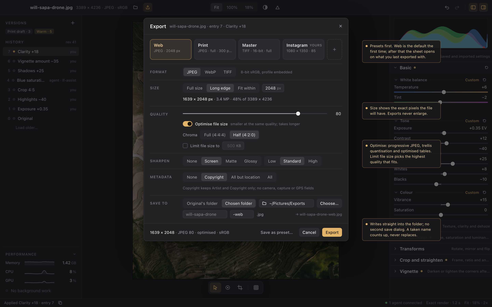

# Export settings

Status: **delivered** on the M4 Mac; the owner authorized implementation on 2026-10-12. The owner asked for more comprehensive export with settings, JPEG, WebP and a lossless hand-off format, and optimised output by default for the web with a separate print setting. The owner's choices of 2026-10-07 are under [decisions](#decisions). The other defaults are recommendations recorded under [proposals](#proposals-with-recorded-defaults). `export.write` and `batch.export` write every setting below, output sharpening included, and the desktop's sheet, menu, palette entries and Select's batch export are delivered over them, with their rendered journey (`cargo xtask smoke --scenario export`, and `select` for the batch). The GPU's resized, 16-bit and sharpened exports are within their declared limits on the whole corpus, and the cost of every format and preset is measured on both renderers ([qualification and measurement](#qualification-and-measurement)). What remains is listed under [outstanding](#outstanding). This design extends the [JPEG export](export.md) and keeps its freeze, render, publish and never-replace rules unchanged.

Boards: [Web preset](export-settings/web.png), [Print preset, changed](export-settings/print.png), [many photographs from Select](export-settings/batch.png) and [components and states](export-settings/components.png). The standalone pages are under [export-settings/html](export-settings/html/index.html).

## Behavior and scope

### The Export sheet

`Cmd+E`, the Export menu's **Export…** and the palette open the **Export sheet**. It is a modal panel over the dimmed workspace, using the same scrim and stacking as the Settings sheet. It exports the displayed entry under the existing rules: the current entry, a history preview, or the fixed After entry while Compare is open, and never a draft. From top to bottom it has:

1. **Preset cards.** Web, Print and Master are built in. The person's own presets follow, then **+**, which saves the current settings as a new preset. The sheet opens on the last settings exported with. The first time, it opens on Web. A preset holds its folder and suffix too, so changing any setting, the folder included, marks the selected card *Changed from preset*. It never saves the change silently: the footer offers **Update "Name"…** for the person's own preset or **Save as preset…**, and Export uses the changed settings once. A built-in preset cannot be updated, renamed or deleted; **Duplicate** makes an editable copy. Right-clicking one of the person's presets offers Update with current settings, Rename…, Duplicate and Delete.
2. **Format.** JPEG, WebP or TIFF. The rows below show only the controls that apply to that format.
3. **Size.** Full size, Long edge *N* px or Fit within *W* × *H* px. A readout below gives the exact output pixels, megapixels and the scale against the output stage. An export is never enlarged: a photograph already within the bound keeps its size, and the readout says so.
4. **Print size** (shown when a density is set; **Set print size** under the size readout adds one, and **Remove** takes it away). The pixels per inch written to the file, and the physical size at that density in inches and centimetres. It changes no pixels.
5. **Quality** (JPEG and WebP). A 1–100 slider, then:
   - **Optimise file size.** The format's slower, smaller encoding at the same quality (see [encoding](#encoding)).
   - **Chroma** (JPEG only). Full (4:4:4) or Half (4:2:0).
   - **Limit file size to** *N* KB, a switch and the kilobytes. Chooses the highest quality, at most the slider's, whose file fits the limit. The slider is disabled while the limit is on.
6. **Bit depth** (TIFF). 16-bit or 8-bit. For TIFF, **Optimise file size** means lossless compression.
7. **Sharpen.** None, Screen, Matte or Glossy, then Low, Standard or High ([output sharpening](#output-sharpening)). The amount is disabled while Sharpen is None, and kept for the next medium chosen. Once the row differs from the selected preset's, a line under it says how: *Changed from Print (Glossy, Standard)*.
8. **Metadata.** None, Copyright, All but location or All (see [metadata](#metadata)).
9. **Save to.** The original's folder or a chosen folder (**Choose…** opens the native folder dialog), then the name: the photograph's stem, an editable suffix and the format's extension. A name already taken is reported in the sheet, with the name that will be written instead (`-2`, `-3` and so on). Nothing is ever replaced.

The footer summarises the export (output pixels, format, quality and colour) beside **Save as preset…**, **Cancel** and **Export**. Escape and Cancel close the sheet without exporting. Export writes the file directly into the folder, with no second save dialog, and closes the sheet. The status bar then reports the export as it does today, now with what the settings decided: *Exported will-sapa-drone-web.jpg · 1639 × 2048 · 612 KB · quality 80*, or *quality 71 to fit 500 KB*.

### Large images and progress

Optimisation, file-size limits and WebP have no memory cap (owner, 2026-10-08 and 2026-10-13): they use whatever memory the image needs, and the sheet says so up front.

- **Warning.** When an optimised JPEG's output exceeds **24 MP**, a size limit applies to an output above 24 MP, or a WebP's output exceeds 24 MP, the sheet shows an amber notice under Quality. For example: *Large image: optimising 60.2 MP holds about 720 MB while encoding and is several times slower. Turn Optimise off to write it as it renders.* The memory figure comes from `export.plan`'s estimate. In batch mode the notice counts the photographs over the threshold and gives the largest estimate. The notice warns; it never blocks or asks for confirmation. Export again and Export with preset show no sheet, so their progress bar is the warning.
- **Progress bar.** Every export reports determinate progress over its phases, rounded to whole percent: rendering, resampling, each encoding pass of an optimised JPEG (through libjpeg's progress monitor), each attempt of a limit search, and writing. The status bar shows a bar with the phase and percent, for example *Optimising DSC_0042-print.jpg · 64%*, as soon as the plan carries the large-image notice, and otherwise once an export has run for one second, so quick exports never flash a bar. Clicking it opens the Performance section, where the export's row has **Cancel**, as every long job does.

The sheet is a client of the API; it holds no export rules of its own. Its readout, suggested name and notices come from `export.plan`. The sheet asks for a plan when a setting the plan depends on changes: the format, size, density, folder or suffix, and Optimise, chroma, the size limit and bit depth, which change its estimate and notices. Quality, sharpening and metadata never ask for one, so the slider plans nothing. At most one plan is in flight, with the newest change pending, and Export is enabled only once the plan for the settings shown has answered and refuses nothing.

### The Export menu and shortcuts

The title bar's Export button opens a menu:

- **Export…** (`Cmd+E`) opens the sheet.
- **Export again as *Preset*** (`Shift+Cmd+E`) exports at once with the last export's settings, folder and suffix, counting the name up if it is taken; it reads *Export again with the last settings* when they were changed from their preset. It is disabled until something has been exported from the sheet, the menu or the palette: only a successful export started there is remembered.
- **Export with preset** lists every preset. Choosing one exports at once with that preset's own settings and folder.

The command palette lists the same entries, one per preset (*Export with preset: Print*), and keeps **Export reference render…**, which opens the sheet and sends `reference: true`. This replaces the two-item menu and the Keep metadata shortcut: metadata is now a setting.

### Many photographs

The Select workspace's **Export N…** opens the same sheet, titled *Export 5 photos* and listing how many are RAW and how many JPEG. One set of settings applies to every photograph. Long edge and Fit within describe each photograph's own bound. With Original's folder, each file is written beside its own original. The name rule is the photograph's stem plus the suffix and the extension, counting up per folder exactly as a single export does. A photograph the settings cannot be applied to is reported as left out, with its reason, never skipped silently: for example, WebP over 16,383 px a side, or an original that is missing. Progress, Cancel and the report are the batch's existing ones in the Performance section and the batch sheet. The batch sheet plans every selected photograph for each change it plans, in one request off the update loop, so before Export it says how many are over the warning threshold and which it will leave out, with the first reason (*1 photo will be left out: WebP holds the whole 10000 × 6000 output…*). The footer's summary and the Export button count only the files it will write, *4 files · 1 left out* and *Export 4*, and Export is enabled while at least one photograph can be written. That notice sits above the footer, outside the scrolled settings, so it is always in view.

### Built-in presets

| Preset | Format | Size | Quality | Other settings | Metadata | Density | Suffix |
| --- | --- | --- | --- | --- | --- | --- | --- |
| **Web** | JPEG | Long edge 2048 px | 80 | Optimise on, chroma 4:2:0, Sharpen Screen / Standard | Copyright | none | `-web` |
| **Print** | JPEG | Full size | 95 | Optimise off, chroma 4:4:4, Sharpen Glossy / Standard | All but location | 300 ppi | `-print` |
| **Master** | TIFF | Full size | lossless | 16-bit, lossless compression, Sharpen None | All | 300 ppi | `-master` |

Every built-in preset saves to the original's folder. Web is optimised by default: smaller pixels, a smaller encoding and no personal metadata. Print favours fidelity and speed at full resolution: it streams as it renders, which is why its Optimise is off by default (see [encoding](#encoding)). Master is the lossless, high-bit hand-off for printing and other editors, so it is not sharpened: what receives it sharpens for its own output.

Colour is sRGB with its profile embedded for every format. Wide-gamut output (Display P3, Adobe RGB) is not in this plan; it needs its own decision and tolerance ([decisions](../decisions.md#export)).

## Settings

One settings object, `ExportSettings`, is shared by `export.plan`, `export.write`, `batch.export`, presets and the remembered last export. Each field is validated by name: a refusal is `validation` whose message starts with `settings.<field>` and whose `data.field` names it. Every field that applies to the format is required, a nullable one sent as `null`. A field that does not apply to the chosen format must be left out: sending it, even as `null`, is refused rather than ignored.

| Field | Values | Applies to |
| --- | --- | --- |
| `format` | `jpeg`, `webp`, `tiff` | all |
| `size` | `{fit: "full"}`, `{fit: "long_edge", pixels}` or `{fit: "within", width, height}`, each bound 16–65,535 px | all |
| `quality` | 1–100 | JPEG, WebP |
| `optimise` | boolean | all; its meaning depends on the format |
| `chroma` | `444`, `420` | JPEG (WebP's lossy encoding is always 4:2:0) |
| `limit_bytes` | `null`, or 10,240–1,073,741,824 | JPEG, WebP |
| `bit_depth` | `8`, `16` | TIFF |
| `sharpen` | `null` for none, or `{medium: "screen" \| "matte" \| "glossy", amount: "low" \| "standard" \| "high"}` | all |
| `metadata` | `none`, `copyright`, `no_location`, `all` | all |
| `pixels_per_inch` | `null`, or 1–65,535 | all; written to JPEG's JFIF header and TIFF's resolution tags, while WebP has no density field and carries none |
| `folder` | `"original"`, or `{path}`, an absolute existing directory | all |
| `suffix` | 0–64 characters, with no path separator, no control character and no leading dot | all |

The output size is computed from the frozen entry's output stage, after orientation, transforms and crop, by scaling both sides by one factor and rounding to whole pixels. The factor is never above 1. A `null` density on the desktop means today's behaviour: on macOS the desktop names 72 pixels per inch for each physical pixel of a point ([export decision 7](export.md#decisions)); everywhere else, and through the API, no density is written. Settings that sharpen for Matte or Glossy paper are the exception: their radius follows the density, so with none set the desktop sends none and the sharpening is for 300 ppi.

## Rendering

The export still freezes the entry, renders through the owner's tile service with the reference renderer as fallback, encodes as the bands arrive where the format allows it, and publishes without replacement ([behavior](export.md#behavior)). Two new outputs join the existing full-size 8-bit export.

**Routing.** The export renders the settings' output (`ExportSettings::output_spec` of the stage) through the tile service, or through `reference_output` when the reference renders: on request, on a host with no GPU, or after a fallback, which starts the export again from nothing so no file mixes renderers. Two routes follow from the settings:
- *Streamed.* A JPEG without a size limit, with Optimise on or off, and a TIFF at 8 or 16 bits take the output's bands as they arrive. An optimised JPEG's passes run after its last band.
- *Held.* A JPEG with a size limit and every WebP collect the output into one frame at 4 bytes a pixel, then encode it: a size-limited JPEG through its limit search, a WebP whole, and a size-limited WebP through the same search.

A refusal `export.plan` can predict (`webp-too-large`, `tiff-too-large`, `folder-missing`) is refused when the export is asked for, with the plan's code, before anything renders.

**Resized output.** The stage is resampled in linear light by a separable Lanczos-3 filter whose support scales with the reduction (`luxforge_core::tiles::lanczos_taps`), then clamped and encoded once to the output. Both renderers resample the stage's terminal values clamped to `[0, 1]`, as the 16-bit terminal holds them, so ringing past white is clamped once more after the filter.
- *The reference renderer* (`luxforge_core::tiles::reference_output`) stands in for the exact frame: a full-size 8-bit output is that frame itself, uncopied; any other output is cut from the stage's terminal encoded once at 16 bits (six bytes a pixel), resampled in `f64` in bands of 16 output rows on the shared pool and encoded once at the output's depth. Exact-buffer tests hold it against a stepwise reference.
- *On the GPU tile worker*, the stream's tiles draw their linear values into the whole output stage, held in `Rgba32Float` beside any staged sweep's stage textures, and the resample sweep reads it in cuts of at most 256 output rows: each cut's window is copied out, summed across and down by the same taps in `f32`, clamped and encoded once, sharpened when the settings ask ([output sharpening](#output-sharpening)), and read back at the output's depth, two cuts in flight and the cancellation checked between them. The held stage and the largest cut are charged to `GPU_TILE_BUDGET` less the stream's read reserve before anything is created; a stage that does not fit is the reference's (`tiles-budget`, or `texture-limit` past 2 × 8,192 textures a side), which renders the whole export again, never mixing renderers. An output pixel whose taps a cut's window cannot hold, at reductions past about 340 times, is the reference's (`texture-limit`).
- *Resize then encode.* Resizing happens before encoding, so the encoder never sees the full-size stage.
- *The full-size 8-bit stream* is unchanged: its tiles' own codes, never held or resampled. Sharpened, a full-size 8-bit output goes through the held stage instead, its taps a single weight of one, as a 16-bit one does.

**16-bit output** (TIFF only). The output encoding produces 16-bit sRGB once, instead of 8-bit. The reference encodes its terminal once at 16 bits. The GPU draws a full-size 16-bit output through the same held stage, each cut's taps a single weight of one, encodes it by the core's 16-bit thresholds and reads its bands back at 16 bits per channel.

**Tolerances.** The owner asked that each of these outputs declare its tolerance when designed. This design declares them as follows; any cell that misses its limit is a defect to fix, not a reason to loosen the limit:
- *Resized output.* Judged against the reference export resized by the reference resampler, within the display limit of the stack's class: the four statistics over every pixel. A linear resampling filter does not add new error classes.
- *16-bit output.* Judged against the reference's 16-bit export, within the same class limits. ΔE00 is computed from the 16-bit values, so the limit is in the same perceptual units.
- *Sharpened output.* Judged against the reference's sharpened export, within the spatial class's limit (1.0 / 2.5 / 5.0 / 0.5) whatever the stack's class: sharpening is a spatial operation, and the GPU's `f32` sum may round a change to the other side of a half code where the reference's integers do not.

Each output is a `gpu-qualification` export kind on the corpus: `export-resized`, `export-16bit` and `export-sharpened` beside `export`. `export-sharpened` is `export-resized`'s output sharpened for Matte paper at High and 300 ppi, the widest radius and the largest amount at the usual density.

### Paged sources

A paged derived source, such as a panorama past the camera limits ([large derived sources](panorama-merge.md#large-derived-sources)), has no whole frame. Every setting is written from it in bounded memory, and neither level 0 nor a full-resolution frame is ever held whole.

- **On the GPU.** The full-size 8-bit stream draws its tiles from windows of level 0, as every paged export does ([rendering, samples and export](panorama-merge.md#rendering-samples-and-export)). A resized, 16-bit or sharpened output holds its whole output stage in `Rgba32Float`, and a paged source's stage always passes one of two limits. Wider than 16,384 pixels, it passes the held stage's 2 × 8,192 textures (`texture-limit`). Above 128 MP, it passes the stream's budget, about 114 MP (`tiles-budget`, checked before the runner plans anything). Such a stream ends before its first band, and the banded reference renders the export.
- **On the reference.** The banded mode (`luxforge_core::render::bands_output`) serves every output. Each band is the whole-frame reference's rows, code for code:
  - *Full size, 8 bits.* The banded mode's own bands, encoded as they arrive (JPEG, 8-bit TIFF), or assembled into the output frame of a held format (a size limit, WebP), which has no cap (decisions 5 and 6).
  - *Full size, 16 bits.* Bands of the wide terminal, the 16-bit codes `Render::wide_frame` holds, made opaque as the whole frame's are.
  - *Resized.* A streaming separable Lanczos-3 in linear light, with the whole frame's taps, sums, clamping and encoding. Each stage row is decoded from a band of the wide terminal and resampled across once, then kept while the vertical taps of the next 16 output rows read it.
  - *Sharpened.* Any of these, sharpened as the bands arrive by the whole frame's own row functions. Each row is sharpened once the radius's rows below it have arrived.
- **Bounds.** These are beside the banded mode's own: a band of at most 2,048 rows and the 512 MiB evaluated-frame limit, its windows within 512 MiB, and the source's chunk cache.
  - A 16-bit band and its opaque codes, together within the evaluated-frame limit.
  - A resized output's one band of the wide terminal, and its rolling stage rows: about `(16 + 6) × 24 × the stage's width` bytes, 34 MB at 65,000 pixels.
  - Sharpening's rows not yet handed on (a band and the radius's rows), and `(64 + 2r) × width × 16` bytes of luma.

  A held format holds only its output frame.
- **Progress, cancellation and never-replace** are every export's. The banded reference reports the phases of output that arrives in bands (the [progress](#progress) table's first two columns). Cancellation is read between bands and between groups of rows. The result names the reference, with the GPU's reason.
- **Evidence.** Exact-buffer tests (`bands_output` tests) hold every output to the whole-frame reference's, code for code, on sources small enough for both: full size at 16 bits, resized at both depths, and sharpened at full size and resized at the narrowest and widest radius. They run at budgets that cut each output into many bands. Owner tests export a paged photograph with the Web and Master presets and a sharpened resized TIFF, each file the banded reference's output encoded. A Web JPEG of a 132 MP paged source passes too; its wide terminal alone would pass the whole-frame evaluated-frame limit.
- **Outstanding.** No GPU resample streams band by band from windows without holding the output stage, so every resized, 16-bit or sharpened export of a paged source is the reference's. Building one would keep these exports on the GPU. Their `gpu-qualification` cells on `derived-paged` record the GPU's reason as a gap.

**Output sharpening.** An unsharp mask applied after resizing, at the final pixel size, to luminance only, in the encoded (gamma) domain, so it adds no colour fringes. It is an export setting, never a recipe layer: Detail's capture sharpening remains the recipe's.

- *Domain.* The output's own codes at its depth (8 or 16 bits), after resampling and encoding and before the file's encoder. Luma is Rec. 709's over the codes, `Y′ = (2126 R′ + 7152 G′ + 722 B′) / 10000`.
- *Kernel.* A Gaussian of standard deviation σ output pixels, separable, truncated at radius `⌈3σ⌉`. Each axis's weights are rounded to integers summing to 4096, the centre taking the rounding's remainder. The change at a pixel is `amount × (Y′ − blur(Y′))`, rounded half away from zero, then held to `[−min(R′, G′, B′), top − max(R′, G′, B′)]` so that no channel clips, and added to R′, G′ and B′ alike. Every channel difference, and so every pixel's chroma, is exactly unchanged. Pixels past the image's border are its edge's.
- *Radius.* Screen's σ is 0.6 px, whatever the density. Glossy's is the density over 360 and Matte's the density over 240, about 0.07 mm and 0.11 mm on paper: 0.83 px and 1.25 px at 300 ppi. σ is held to 0.5–3 px, so the radius is at most 9. With no density, paper sharpening is for 300 ppi.
- *Amount.* Low, Standard and High, as a percentage of the difference added back:

  | Medium | σ (px) | Low | Standard | High |
  | --- | --- | --- | --- | --- |
  | Screen | 0.6 | 40% | 70% | 110% |
  | Glossy | ppi / 360 | 50% | 90% | 140% |
  | Matte | ppi / 240 | 60% | 110% | 170% |

  The constants were set by eye on Web-size and full-size crops of a real photograph: Screen at High adds no visible halo at three times, and paper sharpening looks crisp to crunchy on screen at 1:1, as print output sharpening does. Their judgement in print is open.
- *The reference* (`luxforge_core::tiles::sharpen`) sharpens the output frame in place, in bands of 64 rows on the shared pool, reading a rolling window of the band's rows and the radius's either side. It computes in integers, so the bands, the pool and their order change no code. Exact-buffer tests hold it to a stepwise two-dimensional reference at every medium and amount, across band edges, at image borders and where the hold applies, and hold every chroma unchanged on saturated edges.
- *On the GPU* it is the resample sweep's last pass. Each cut's codes are computed the radius wider on every side, held to the output's edges, and the pass reads them and writes the cut's interior alone, so no cut or band edge shows. It computes in `f32` with the reference's weights over 4096 and rounds and holds the change as the reference does. An output pixel whose window, with the radius's pixels either side, passes the sweep's scratch, as a reduction of about a hundred times sharpened for paper can, is the reference's (`texture-limit`).

## Encoding

| Format | Encoder | Streams bands | Optimise file size | Limit file size |
| --- | --- | --- | --- | --- |
| JPEG | libjpeg-turbo through the existing pinned `mozjpeg` crate | Yes, with Optimise off | Progressive scans, optimised Huffman tables and trellis quantisation, keeping the standard (Annex K) quantisation tables so a quality value means the same with Optimise on or off | Yes |
| WebP | libwebp through a pinned `libwebp-sys` with the vendored C source and its mux API | No: libwebp encodes a whole picture | The slowest, best method and sharp RGB-to-YUV conversion | Yes |
| TIFF | the pinned `tiff` crate | Yes, by strips | Lossless Deflate with the horizontal predictor | No (lossless) |

**JPEG optimisation needs memory.** Every mozjpeg optimisation (progressive scans, optimised tables, trellis) keeps the whole image's coefficients in two arrays. That is about 12 bytes per pixel at 4:4:4 and 6 at 4:2:0, about 720 MB for a 60 MP image at 4:4:4. By the owner's decision of 2026-10-08 Optimise always applies, whatever the size: the memory is bounded by the output's own size, not by a cap. `export.plan` reports the estimate, and the sheet warns above 24 MP ([large images](#large-images-and-progress)). The scans are mozjpeg's fixed progressive script of nine, not its scan search, which would hold every candidate scan outside the estimate and skip passes. The encoder reports each pass through libjpeg's progress monitor, as an equal share of the encode, and checks cancellation between and within passes; a cancel leaves libjpeg through its error path, as its own errors do. With Optimise off, JPEG is the current streamed encoding, byte for byte.

**WebP** holds the output frame. It is limited to 16,383 px a side; a larger output is refused before anything renders, naming the limit. ICC and EXIF go in through the mux, as ICCP and EXIF chunks. WebP has no density field, so a WebP carries no pixels per inch.

**TIFF** is RGB, 8 or 16 bits per channel, written by strips as the bands arrive. Its ICC profile goes in tag 34675, its EXIF in an Exif IFD, and its descriptive fields in IFD 0. A TIFF whose worst-case size, uncompressed with its tags, could pass the format's 4 GiB is refused before anything renders, `tiff-too-large`.

**Limit file size** holds the encoder's input, the output frame after resizing, and searches quality by bisection from the slider's value downward. It encodes into memory, tries the slider's quality first, then bisects from 10 up to one below it, the higher middle first: at most eight encodes, each stopped as soon as its file passes the limit, and it writes the highest quality that fits. It has no size cap: it holds the output frame at 4 bytes per pixel, and each attempt is a whole encode, so the sheet warns above 24 MP and progress counts the attempts. If nothing fits at quality 10, nothing is written: the refusal is `validation` with `data.code` `limit-unreachable`, naming the limit. The result names the quality used.

## Metadata

The levels select from the existing [supported fields](export.md#supported-metadata); nothing else is added or round-tripped:

| Level | Fields |
| --- | --- |
| None | No EXIF, IPTC or XMP: only the format's header and the ICC profile |
| Copyright | Artist, Copyright |
| All but location | Every supported field except the GPS group |
| All | Every supported field |

Any level other than None also writes the structural fields the export defines (Orientation 1, ColorSpace sRGB, the output's pixel dimensions and `Software`), as today. JPEG carries them in its APP1 segment, WebP in its EXIF chunk, and TIFF in IFD 0 plus its Exif and GPS IFDs.

## API

| Method | Envelope | Behavior |
| --- | --- | --- |
| `export.plan {asset_id, entry_id?, settings}` | none | Renders nothing. Answers `{asset_id, entry_id, snapshot_id, stage: {width, height}, output: {width, height}, physical?: {inches, centimetres}, suggested, estimate, notices, stale}`. `physical` is present with a density, each side to a hundredth. `suggested` is the absolute path `<stem><suffix>.<ext>` in `folder`, then `-2`, `-3` and so on, reading at most 64 names; it is `null` when the folder is missing or the photograph has no original to name it after. `estimate` gives the bytes the encoder will hold beyond the streamed bands. `notices` are `{code, message, refuses, bytes?}`: `large-image` (an optimised JPEG, a limit or a WebP above 24 MP, with the estimate in `bytes`), and the refusing `webp-too-large` (a side above 16,383 px), `tiff-too-large` (a TIFF that could pass 4 GiB) and `folder-missing`. A refusing notice is what `export.write` and `batch.export` refuse with: `validation` with `data.notice` naming the code |
| `export.write {asset_id, entry_id?, settings, destination, reference?, acknowledge_stale?}` | request | Replaces `export.jpeg`, which no longer exists. The destination is an absolute path whose extension matches the format (`.jpg`/`.jpeg`, `.webp`, `.tif`/`.tiff`), refused with `validation` naming `destination` otherwise and with `conflict` if anything exists there. It need not be inside `folder`, but a `{path}` folder must exist. A photograph saving to `"original"` with no original folder, such as a merge result, is refused `folder-missing`; a missing original is refused as an unavailable source. Freezing, stale acknowledgement and retries are as before: a retry with the same request id and parameters is answered from the stored answer. The answer echoes `settings` |
| `job.read` | none | As today, now with determinate progress: `progress.fraction` over the whole export, in whole percent and never going back, and `progress.message` naming the phase (`rendering`, `resampling`, `encoding`, `optimising`, `limiting k/8`, `writing`; see [progress](#progress)). `result` is `{path, bytes, width, height, format, quality?, optimised, metadata, renderer, acknowledged_stale}`: `quality` is a JPEG's or WebP's, under a size limit the quality the search chose, and is absent for a TIFF |
| `batch.export {targets, settings, mutation}` | as today | Exports each photograph's current entry with the settings, into `folder` (each photograph's own folder for `"original"`) under the name rule. The report lists `written: [{asset_id, path, renderer, quality?}]` and `skipped: [{asset_id, code, reason}]`, every photograph left out with its code: a refusing notice's (`webp-too-large`, `tiff-too-large`, `folder-missing`), `limit-unreachable`, or the code the single export refuses it with. It cancels between photographs and within one, removing that one's temporary file |
| `export.presets.list` | none | `{presets}`: built-in and the person's presets, `{preset_id, name, builtin, settings}`, built-in first (`luxforge.web`, `luxforge.print`, `luxforge.master`), then the person's by name ignoring case |
| `export.presets.create {name, settings}` | change | Answers `{preset}`, with a new id `export-preset-<32 hex digits>`. Names are 1–64 characters with no control character and no leading or trailing space, unique ignoring case among every preset, built-in included (`conflict`). At most 100 of the person's presets (`resource_limit`) |
| `export.presets.update {preset_id, name?, settings?}` | change | Answers `{preset}`. A built-in or unknown preset is refused with `validation` |
| `export.presets.delete {preset_id}` | change | Answers `{outcome, deleted}`. A built-in preset is refused with `validation`; an unknown one is a no-op |

The person's presets live in a JSON document of their own, `export-presets.json`, beside `preferences.json` in the host's configuration directory, outside every catalog. Every value in it is checked, and an unreadable or unsupported document is kept and refused by name rather than rewritten. The last export's settings and preset id are a remembered preference, `export_last`, with no Settings row. It is stored only after an export the person started from the sheet, the menu or the palette succeeds. It replaces the remembered `export_folder`, whose role a chosen folder now plays. It is `{settings, preset_id}` through `preferences.read` and `preferences.set`, `preset_id` being `null` or the preset the settings came from unchanged. Without a configuration directory, `export.presets.list` answers the built-in presets and every change is refused `not_ready`. `schema.list` describes `ExportSettings` once, as `export_settings`, and every method above refers to it.

`export.write` and `batch.export` write every value above, `sharpen` included.

### Progress

An export's progress is one fraction of the whole job, reported to the activity board (and so `job.read`) in whole percent, never going back, with the phase as its message. Each phase is a span of the whole, by these weights normalised over the phases the export has:

| Phase | In bands, streamed | In bands, held | Reference, whole frame |
| --- | --- | --- | --- |
| `rendering` | 0 (the bands are counted as they are encoded) | 20, by bands collected | 30, as one step |
| `resampling` | — (within the bands) | — (within the bands) | 10, only for an output smaller than the stage, at 16 bits or sharpened; it includes the sharpening |
| `encoding` | 95, or 30 when optimised | 70 for a WebP without a limit | 55, or 15 when optimised; 70 for a WebP without a limit |
| `optimising` | 65, when optimised | — | 40, when optimised |
| `limiting k/8` | — | 70 | 70 |
| `writing` | 5 | 5 | 5 |

Output arrives in bands from the GPU's stream, and from the banded reference of a [paged source](#paged-sources). A streamed encode reports the rows it has encoded over the output's height. An optimised JPEG then reports libjpeg's passes as equal shares of `optimising`. A limit search shares `limiting` among the attempts it still plans, each reporting its encode's progress within its share and never going back, its message naming the attempt: `limiting 2/8` and so on. A held WebP reports libwebp's own progress. On the GPU, resampling happens in the tile worker's sweep, so it is part of `encoding` (streamed) or `rendering` (held) rather than a phase of its own. When a stream stops part-way and the reference renders again, the reference's phases share what is left from where the stream got to, so the fraction never goes back.

## Bounds and cost

- **Full size, Optimise off.** JPEG and TIFF keep today's streaming bounds: at most three bands of the output's width. A 16-bit band is twice an 8-bit one.
- **Resized output on the GPU.** The content stage is held as stage textures on the tile worker inside `GPU_TILE_BUDGET`, as staged sweeps are today, plus bands of the output's width.
- **Resized output on the reference.** The reference renders its existing exact frame and resamples it into an output frame, at most the stage's size. Both stay inside the 512 MiB evaluated-frame limit. A paged source's output is rendered in bands instead ([paged sources](#paged-sources)).
- **Output sharpening.** The reference sharpens the output frame it already holds, in place, with a band's luma and its across sums for the band and the radius's rows either side: no second frame. On the GPU each cut is computed at most 9 pixels wider on each side, with one more buffer of the cut's sharpened codes, charged with the cut; a full-size 8-bit output held to be sharpened takes the held stage a 16-bit one takes.
- **Optimised JPEG.** Coefficient arrays of about 12 bytes per output pixel at 4:4:4, or 6 at 4:2:0, with no cap (owner, 2026-10-08): `luxforge_jpeg::coefficient_bytes`, which its tests hold to what libjpeg allocates, about 288 MB at 24 MP and 723 MB at 60 MP at 4:4:4. This follows the shared memory budget rule: the budget is a target that keeps memory low, not a limit that refuses the person's work ([decisions](../decisions.md#rendering-memory)). One export runs at a time on the lane, and a batch exports one photograph at a time, so at most one image's arrays are held.
- **Limit file size.** The output frame at 4 bytes per pixel, with no cap, plus one attempt's arrays when optimised and two files each at most the limit, the attempt's and the best so far. Attempts run one after another, so an optimised attempt's arrays are released before the next one starts.
- **WebP.** Holds the output frame, at most 16,383 px a side, plus libwebp's state, which `luxforge_core::export::webp::webp_held_bytes` bounds at 4 bytes a pixel, or 11 optimised, from the codec's footprint tests, and with a limit the best file so far. It has no memory cap (owner, 2026-10-13): above 24 MP the plan carries `large-image` with that estimate, and only the format's own side limit refuses, as `webp-too-large`. A frame held from the GPU's bands is allocated at its size, and an allocation the host cannot make is refused as `resource-limit`; the reference renders the export within its own evaluated-frame limit, as it renders every frame.
- **The estimate.** `export.plan`'s `estimate` and the `large-image` notice come from `ExportSettings::held_bytes`, which calls the encoders' own figures, so the plan and the encoders cannot disagree. Tests hold it to those figures at 24 MP and 60 MP; the figures themselves are measured by the codec crates' tests.
- **Off the owner thread.** Nothing new runs on the catalog owner beyond planning in `O(layers)`, settings validation and bounded checks of at most 64 names. Encoding, resampling and limit searches run on the export lane. The export lane keeps one running job and four waiting.

## Decisions

Owner, 2026-10-07, choosing from proposed options after this design's boards:

1. **Formats are JPEG, WebP and TIFF.** DNG is not exported. The lossless hand-off is a 16-bit (or 8-bit) TIFF with the edits baked in, the Master preset.
2. **Lossy WebP is in,** through libwebp.
3. **The Export sheet writes directly** into the folder its settings name, with an editable suffix. There is no second save dialog. The same sheet serves batch export, Export again and Export with preset.
4. **Output sharpening is in this plan, delivered after the core:** formats, resizing, optimisation and presets first, then Screen / Matte / Glossy × Low / Standard / High with its own reference, GPU program and tolerance.

Owner, 2026-10-08:

5. **Optimisation has no memory cap.** Optimised JPEG and file-size limits use the memory the image needs, at any size. Long exports show a progress bar, and the sheet warns about large images.

Owner, 2026-10-13:

6. **WebP has no memory cap either.** A WebP of any size within the format's 16,383 px a side is written, warned about above 24 MP as the others are, rather than refused past the 512 MiB frame limit.

The owner's request for settings supersedes the earlier "quality fixed at 90, metadata chosen per export, no export preference" ([preferences](preferences.md#decisions)). The never-replace, never-a-draft and displayed-entry rules of the [JPEG export](export.md#decisions) stand.

## Proposals with recorded defaults

Each of these stands until the owner records otherwise. The implementer owns routine layout, sizes and code organisation within them.

| Question | Default this plan builds | Alternative |
| --- | --- | --- |
| Built-in presets and their values | Web, Print and Master as tabled above | Other values or other presets |
| Where the person's export presets live | `export-presets.json` in the host's configuration directory, outside every catalog | In the catalog, as Develop presets are |
| Resampling filter | Separable Lanczos-3 in linear light, clamped | The existing linear-light area average, which is cheaper and softer |
| Large-image warning threshold | 24 MP of optimised or size-limited output | Another threshold, or a memory figure instead |
| When the status bar shows a progress bar | From the start when the plan warns; otherwise after one second | Always, or only in the Performance section |
| JPEG quantisation tables | The standard Annex K tables for both settings | mozjpeg's own tables when optimising, which change what a quality value means |
| Limit file size | JPEG and WebP at any size, bisection of at most eight encodes | JPEG only, as Lightroom does |
| Metadata levels | None, Copyright, All but location, All | Lightroom's finer set, such as Copyright and contact |
| Shortcuts | `Cmd+E` opens the sheet; `Shift+Cmd+E` exports again | `Shift+Cmd+E` opens the sheet on Web |
| Export reference render… | Opens the sheet and sends `reference: true` | Exports at once with the last settings |

## Acceptance and evidence

1. **Settings.** Every field validates by name, including fields a format does not use. Output sizes match an independent calculation for portrait, landscape, a cropped or rotated stage, and every fit with bounds above, at and below the stage, which is never enlarged.
2. **Formats.** Each file is decoded by an independent decoder: JPEG by `zune-jpeg`, WebP by `image-webp` (a test-only dependency), and TIFF by the `tiff` crate's decoder with the repository's own TIFF walker reading the tags. The dimensions, bit depth, chroma, progressive or baseline encoding, ICC profile, density and metadata fields each setting names are checked in the decoded file. A level's fields are exact against the field table.
3. **Optimise.** An optimised JPEG at a given quality is smaller than the baseline at the same quality on the corpus, with the standard tables. Optimise applies at every size, and `export.plan`'s memory estimate matches the coefficient arrays measured in tests. TIFF compression is lossless: the decoded pixels are identical with and without it.
4. **Limit file size.** The written file is at most the limit at the highest quality the bisection finds. The quality used is reported, and an unreachable limit writes nothing.
5. **Large images and progress.** The sheet's notice appears exactly when an output passes the warning threshold, with the plan's estimate. A job's progress rises monotonically through every phase, encoding pass and limit attempt. The status bar shows the bar from the start for a warned export and after one second otherwise, and Cancel in the Performance section stops an optimised encode between passes and a limit search between attempts.
6. **Pixels.** Exact-buffer tests cover the reference resampler, 16-bit output encoding and output sharpening. `gpu-qualification` holds the GPU's resized, 16-bit and sharpened exports to the reference within the declared limits on the corpus. A stream that stops part-way still restarts on the reference, so no file mixes renderers.
7. **Never destructive.** The original's checksum, the catalog's history and every existing file are unchanged by every export, refusal, cancellation and limit search. Temporary files are removed on failure and on cancel.
8. **Parity.** The sheet, the menu, Export again, Export with preset and Select's batch each send exactly what an independent JSON client sends for the same settings, and produce the same files. Presets created, updated and deleted through the API appear in the sheet, and the reverse.
9. **Rendered journey.** A background rendered journey on the owner's M4 correlates the sheet's state, logs, captures and written files across:
   - Web, Print and Master on a generated 24 MP JPEG and a supplied RAW
   - a changed preset that is saved, updated and deleted
   - Export again
   - a taken name
   - Web's and Print's sharpening, read from their files
   - a batch of mixed sources with one left out
   - a WebP refused past 16,383 px a side
   - an optimised 60 MP export, with its warning, progress bar and a cancel
10. **Measurement.** Measured once, after feature work, on the M4 in release, for 24 MP and 60 MP on both renderers: wall time and peak additional memory per format and preset, the cost of Optimise (whose measured rate may then refine the warning's wording), the number of encodes a limit search takes, and resampling's share of the export.

## Performance-rules review

The [checklist](../engineering/performance-rules.md#review-checklist), answered once for the finished change:

- **Reading the original.** Unchanged. `export.write` and `batch.export` read the original only through the prepared, verified source, and a batch prepares each photograph on the source worker in turn. `export.plan` reads, hashes and decodes nothing.
- **New full-frame allocations.** On the reference: the stage's terminal at 16 bits (six bytes a pixel) for a resized, 16-bit or sharpened output, and the output frame cut from it; within the 512 MiB evaluated-frame limit. A full-size 8-bit output is the exact frame itself, read in place, and sharpening works in place on the output frame. A held format's frame (4 bytes a pixel), Optimise's coefficient arrays (`luxforge_jpeg::coefficient_bytes`) and libwebp's state (`webp_held_bytes`) scale with the output with no cap, by the owner's decisions of 2026-10-08 and 2026-10-13, are reported by `export.plan` and warned about above 24 MP, and only one export holds them at a time. On the GPU: the held output stage in `Rgba32Float` (16 bytes a pixel) and its largest cut, charged to `GPU_TILE_BUDGET` before anything is created, or the reference's (`tiles-budget`, `texture-limit`). A paged source is served in bands within the bounds of [paged sources](#paged-sources). A band is shared with the encoder, not copied.
- **No frame for a plan or validation.** `export.plan` and settings validation never render. The sheet plans only on changes that affect the plan, one plan in flight.
- **Owner thread.** Planning in `O(layers)`, validation and at most 64 name checks a plan; the batch sheet's one plan request covers every selected photograph. All frame work runs on the export lane or the tile worker.
- **Desktop messages.** The sheet adds plan calls and job reads only: no `asset.state`, history refresh, preview job or upload. The existing job-read stream reads the export.
- **Timers.** None are added. Job reads stay gated on a queued or running job. Progress is rounded to whole percent, so a running export sends at most about a hundred progress updates. The one-second delay before the bar appears uses the job's own elapsed time on its reads, not a new timer.
- **Caches.** None are added. A limit search re-encodes the frame it holds and never renders again.
- **`editor-performance`.** Not run: its 24 MP workload does not export. Export is measured directly by `export_settings_measurement` ([measurement](#qualification-and-measurement)), whose scope is recorded in [performance](../specs/performance.md#export-settings).
- **Pixel tests.** Exact-buffer tests hold the reference resampler, 16-bit output encoding, output sharpening and every banded output of a paged source (`bands_output`) to stepwise references. `gpu-qualification`'s `export-resized`, `export-16bit` and `export-sharpened` kinds hold the GPU's outputs to the reference within the declared limits on the whole corpus ([qualification](#qualification-and-measurement)). Band-sharing tests support the no-copy claim.

## Qualification and measurement

**Qualification.** `gpu-qualification --kind export,export-resized,export-16bit,export-sharpened` with the private RAW manifest, on the M4 Pro's Metal adapter, over the whole corpus with every generated fixture present, the zone plates included:

| Kind | Stacks within the limit | Past it | Gaps |
| --- | ---: | ---: | --- |
| `export` | 414 | 0 | none |
| `export-resized` | 409 | 0 | the 5 stacks over the paged derived source, which the reference renders (`tiles-budget`, [paged sources](#paged-sources)) |
| `export-16bit` | 409 | 0 | the same 5 |
| `export-sharpened` | 409 | 0 | the same 5 |

Every GPU export was the same bytes from a second device. Ten of the corpus's 424 stacks did not run for any kind: the model-mask and frozen-patch stacks over the Z 6 and Air 2S RAWs, whose setup fails before rendering because the qualification harness does not bind their artifact to the RAW stack (`source-unavailable`). They are a defect of the harness, not of export. The run is a selection of kinds, so the release gate counts it incomplete; its export rows are the whole corpus. The worst figures per kind are in [GPU-first](gpu-first.md#the-contract).

**Measurement.** `export_settings_measurement`, in release, times every format and preset on both renderers (the generated 24 MP and 60 MP JPEGs and the Nikon Z 6 NEF, Basic exposure alone) and reads each export's peak memory in a process of its own; the figures and their scope are in [performance](../specs/performance.md#export-settings). What they decide:

- **The large-image warning's wording stands.** Optimise makes a full-size JPEG export several times slower on both renderers, its encode about ten times slower, and a limit search takes seven or eight encodes; the notice's *several times slower* describes both.
- **The memory estimate holds.** Optimise adds about what `luxforge_jpeg::coefficient_bytes` estimates to the reference's peak, and no more.

## Outstanding

- **A GPU resample that streams from windows.** A paged source's resized, 16-bit or sharpened export is the reference's ([paged sources](#paged-sources)).
- **The held output stage's cost on the GPU.** A full-size sharpened or 16-bit export on the GPU goes through the held `Rgba32Float` stage and its cuts. Over a light stack on a JPEG it is slower than the reference's, which renders such a stack in milliseconds, and its stage holds 16 bytes an output pixel in the tile worker's budget. Over the Z 6 RAW, whose reference render takes longer, the two are about as fast. Streaming a full-size output's cuts without the stage would remove both costs.
- **Output sharpening's judgement in print.** Its constants were set by eye on screen ([output sharpening](#rendering)).
- **The harness's RAW artifact stacks.** The ten model-mask and frozen-patch stacks over RAW sources do not run in `gpu-qualification`, for any kind.
- **Native GPU evidence on Windows and Linux.** Qualification and measurement ran only on the M4 Pro's Metal adapter.
- **Wide-gamut output** needs its own decision and tolerance ([decisions](../decisions.md#export)).
