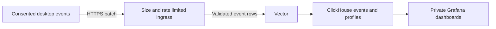

# Optional usage and performance statistics

Status: the working client is implemented. Consent, the startup claim, the `usage.*` commands, eligibility and build identity ([implemented consent](#implemented-consent)), the instrumentation of shipped operations ([coverage](../engineering/usage-statistics-coverage.md)), the supervisor and its sender ([implemented delivery](#implemented-delivery)), the desktop's notice and Privacy tab ([settings](settings-and-flags.md)) and the desktop integration that starts the supervisor in an eligible launch ([implemented integration](#implemented-integration)) are implemented. The local reference backend and its deployment checklist are prepared, and the real desktop has been run against that backend ([backend reference](#open-source-backend-reference), [the backend journey](#the-backend-journey)). `api.luxforge.app` has a hosted Cloudflare backend ([hosted backend](#hosted-backend)). Production reporting stays switched off pending Will's separate activation decision; visible developer builds are eligible for consented test-tenant reporting ([build identity and activation](#build-identity-and-activation)). Evidence uses explicit test eligibility. The native measurement on the M4 with generated 24 MP and 60 MP inputs is recorded and meets the planning budgets ([performance](../specs/performance.md#usage-statistics-measured-on-the-m4)); the supplied RAWs' drags, originals and exports are qualified on the M4 too. Windows and Linux, and hosted privacy/retention qualification, remain open ([acceptance](#acceptance-and-evidence)).

## Outcome and scope

Ask once when a person opens the desktop whether they want to help improve Luxforge by sharing usage and performance statistics. After an explicit yes, record meaningful operations across Select, Develop, tools, masks, history, presets, settings, import and export as a timeline of typed events, with periodic performance samples, app/OS versions and bounded CPU/GPU/memory details. A random persistent installation ID links reports across launches, and a random per-launch session ID strings one session's events together, so a session can be followed in order and an installation's sessions compared over time. Settings always offers opt-in and opt-out. Editing, opening, importing, exporting and quitting never wait for delivery.

An event says what kind of thing happened, when, and in Develop to which image by a keyed image ID. For example, a session's timeline can show that image `3f9c…` was opened in Develop, Basic was committed twice, a mask was added and that image was exported 812 ms later, and a later session can show the same image opened again. It cannot name the photograph, show its contents, report the Exposure value or say which file was exported, and the image ID cannot be turned back into the file. Event order, timing and per-image linking are the point; personal information and photo contents, names and metadata remain excluded. Delivery is best effort: losing statistics is preferable to retaining a backlog or slowing the editor, and lost events show as gaps in a session's sequence numbers.

The client contract and a locally runnable, open-source backend reference, including per-session timeline and simple path queries, are in scope. Accounts, unique-person counts, crash reporting, remote configuration and production hosting are outside it. A reporting-installation count is possible; it must not be described as people or physical devices. DNS, certificates and a production deployment are external inputs to a live-endpoint check, not prerequisites of client implementation or local verification.

The persistent ID, device details, linkable timelines and per-image IDs make these reports **pseudonymous**, not fully anonymous. No name, contact information, IP address, photo content or photo metadata is collected or retained as statistics. Do not promise that a stable random ID or a device profile is impossible to link to other information.

## Consent and first launch

Consent belongs to the person's application configuration, outside catalogs and recipes, alongside the [preferences](preferences.md). A new or existing configuration with no statistics choice starts off. A release update or a different catalog does not reset the choice.

Persist a protected `usage_statistics` record in `preferences.json`:

```json
{"prompt_shown": true, "enabled": false, "disclosure_version": 1}
```

An absent record means `prompt_shown: false`, `enabled: false`. An enabled record additionally holds an `installation_id`: a cryptographically random UUIDv4 created and persisted on the disabled-to-enabled transition, never derived from a username, hardware identifier, catalog, photo, IP address or machine fingerprint. It stays stable across launches, app upgrades and catalog changes for this configuration while sharing is enabled; setting an already enabled choice to true is a no-op and keeps the ID. A successfully saved opt-out deletes it; a later explicit opt-in creates a new ID. No ID exists before agreement or for a refusal. It is a reporting identifier, not an authentication secret. The same transition creates an `image_key`, 32 cryptographically random bytes that key the [image ID](#privacy-device-context-and-the-event-registry); it is stored and removed with the installation ID, and unlike it is never uploaded, logged or returned by any read. The disclosure version identifies the described data classes and destination. The only supported record shape is the current shape; unsupported or malformed preferences remain unchanged and statistics stay off. The startup prompt is suppressed when the preferences cannot be read or written. There is no recovery path that replaces the person's file or treats a read failure as permission.

On the first eligible desktop opening, after the workspace can be used and once the [Select introduction](select-introduction.md) is closed, if it is showing, the desktop calls `usage.prompt.claim`. A bounded atomic write marks `prompt_shown: true` and keeps collection disabled **before** the notice is displayed. Only the instance winning that claim displays it. The write is bookkeeping, an explicit exception to the ordinary rule that preferences store only chosen values. A crash, dismissal or close after the claim cannot produce another automatic prompt. Once means once per retained configuration; deleting that configuration removes the record.

Use a small non-modal notice in the workspace, with no focus grab or keyboard trap. It does not cover the photograph's controls, defer the first usable frame or queue behind editing commands. Delay presentation while a native dialog or another consent notice is open; if the app closes first, do not ask again. No option is selected automatically:

> Help improve Luxforge?
>
> Luxforge can send usage events to api.luxforge.app for debugging and analytics. They never include your name, contact details, IP address, photos, filenames or photo metadata. You can change this in Settings › Privacy.

Buttons: **Share statistics** and **No thanks**. Close or Escape means No thanks. No thanks is neutral, equally accessible and never followed by another startup request or reminder.

Share statistics becomes effective only after its choice and new ID are saved successfully. Nothing from before consent is buffered or backfilled, including the current launch or work already in progress. Settings uses the same disclosure and command. A setting changed to off immediately disables producers, advances the collection generation, clears every buffer/device snapshot and cancels the active request before its persistence is attempted. A successful off write removes the stored ID without resetting `prompt_shown`. A failed off write leaves this process off, shows the ordinary preference-save error and makes clear that the stored choice/ID were not changed; it must not be silently re-enabled by a readback. Bytes already received by the server cannot be recalled; accepted events expire after 90 days in R2 and after Cloudflare's three months in Analytics Engine.

## Settings and programmatic parity

In an eligible launch, the Settings sheet has a **Privacy** tab with **Share usage and performance statistics**, off by default, the same disclosure, and a collapsed **What is sent** list of the event, ID and device fields below for anyone who wants the detail. The disclosure itself says only that events are tracked for debugging and analytics and what they never include; it does not claim the reports are anonymous or contain no personal data, since they carry persistent random identifiers. Changing it applies at once without a relaunch. The switch reports the effective choice and any failure to save it. There is no Send now button, connectivity warning, backlog indicator or automatic retry toast.

These methods are registered, with their schemas, in the same command service used by the GUI:

| Method | Contract |
| --- | --- |
| `usage.read {}` | Return `prompt_shown`, stored consent, effective collection state, disclosure version, destination, the local installation ID when enabled, and a fixed reason when disabled (choice, launch mode, build, inactive destination, unreadable configuration or changed disclosure). Return the current session ID (never the image key), the machine-readable event/device allowlist and delivery limits, and bounded local diagnostics (events recorded, dropped and sent); expose no buffered events, file contents or network error text. No network request. |
| `usage.prompt.claim {mutation}` | Require the host's permission authority. Atomically claim the first eligible startup notice; return `show_prompt: true` only to its first claimant. A duplicate request returns no instruction to show it again. Already answered, ineligible and headless cases return false. |
| `usage.set {enabled, disclosure_version?, mutation}` | An explicit true requires permission authority and the current disclosure version, as grants do. A false is allowed to ordinary connected clients as revocation; reject a disclosure argument on false. Save outside the catalog, emit a local change event and return effective state. Unsupported keys or versions fail explicitly. |

Use the `{request_id, actor}` mutation envelope and authoritative request handling. An actor string or same-user socket access cannot grant consent. The live-session CLI can read or disable statistics but cannot enable them, matching [module consent](module-capabilities.md#capability-and-consent-contract). A trusted programmatic host with explicit permission authority can use the same enable command; the desktop's notice is not an independent source of permission.

`preferences.read` also reports the stored protected record without its `image_key`; `preferences.set` cannot modify or reset it, even with `null`. Its generic reset path must not cause another prompt or bypass permission authority. Both command schemas describe that restriction. Telemetry operations and their reads are never counted as usage events. Local consent events can contain their ordinary actor/request metadata; they never enter uploaded statistics.

One process-wide statistics supervisor serves all of a desktop process's catalogs and clients. Consent changes from its own clients update an open Privacy tab through event synchronization. There is no preferences file watch or polling timer: before detaching a window and again before every network handoff, the worker rereads the stored record off the owner. A stored opt-out, or an installation ID different from the one in memory (another process opted out and back in), ends the current generation, clears every buffer and stops producers in this process, so another process's revocation can never be followed by an upload. A request already handed to the transport has the same unavoidable cancellation limit as a local one.

Visible debug/developer builds can prompt and collect consented test data. Hidden, background, evidence, test and headless launches stay suppressed regardless of stored consent, except explicit evidence/test receiver eligibility. `luxforge-json` never starts this feature. A CLI or future MCP call attached to an eligible, opted-in desktop is counted at the shared operation boundary. Tests inject a receiver and explicit test eligibility into isolated configurations; they cannot send to the production URL. Only the exact hosted test URL is additionally allowed. There is no command or environment override that forces real collection without consent.

### Implemented consent

The core implements the record, the claim and the three commands (`crates/luxforge-core/src/usage/consent.rs`, `eligibility.rs`); the [preferences design](preferences.md#protected-usage-statistics-record) describes the record's place in `preferences.json`. Choices recorded within the delegated contract:

- One process-wide consent runtime reaches every catalog owner through `HostConfig::usage_consent`; hosts that do not pass one get a headless runtime, which is never eligible. It reads the stored record once per process, when the first owner starts; no later owner, read or readback turns collection back on after this process turned it off.
- `usage.prompt.claim` refuses a client without permission authority with `forbidden`. A preferences file that cannot be read or written is an error, not a claim, and is kept unchanged.
- An enable in an ineligible launch is refused with `not-ready` naming the reason and writes nothing; an opt-out is always accepted. Either saved choice also records `prompt_shown: true`, so a choice made through the API is never followed by the startup notice.
- Consent saved for another disclosure version is kept on disk but collects nothing, and agreeing to the current disclosure creates a fresh installation ID and image key.
- When the preferences cannot be read, `usage.read` answers `prompt_shown` and `enabled` as `null` with reason `unreadable-configuration`. An ineligible launch's reason comes first, in the order inactive destination, build, launch mode.
- A retried `usage.set` or `usage.prompt.claim` never applies again: it answers the state as it is now, and a claim's retry never answers `show_prompt: true`. The runtime also remembers the last 64 `usage.set` request IDs for the process, so a retried enable stays revoked after the owner's request table forgets it or the catalog changes.
- A failed opt-out write is an error whose `data.state` reports the stored record as it really is, with collection already off in this process.
- The statistics worker calls `Usage::confirm_stored` before detaching a window and before every handoff. It rereads the record off the owner and ends the generation on an opt-out, an unreadable file, another disclosure, or an installation ID different from the one in memory.
- `usage.read` answers `session_id: null` until the worker starts a session, `diagnostics` as zero counts until it reports them, and also `release`.

### Build identity and activation

Ordinary builds are version `0.0.0`, and a tag build (`cargo xtask release-build`) takes its version from the release tag, so the version alone cannot separate builds when performance is compared. `cargo xtask package` and `cargo xtask release-build` therefore embed the clean source revision in the executable at build time. The reported release is the application version's numeric `MAJOR.MINOR.PATCH` (a tag's pre-release or build suffix is dropped; the revision already tells builds apart) plus the first 12 hexadecimal characters of that revision (`0.0.0+9d4138ca1f2e`, or `0.1.0+9d4138ca1f2e` for a `v0.1.0-rc.1` tag build), a public fact about open-source code. A build without an embedded revision (an ordinary `cargo` or `cargo xtask develop` build) or from a dirty tree, including a `--allow-dirty` rehearsal, reports only as test data. The revision reaches the core as the compile-time variable `LUXFORGE_SOURCE_REVISION`, which both commands set only for a clean tree, removing any inherited value otherwise; the version comes from `LUXFORGE_RELEASE_VERSION` when a tag build sets it. `build.json` records the resulting release (`release` from `package`, `usage_release` from a tag build; `null` for a dirty tree).

For visible desktop launches (`Interactive` or `Developer`), any of `cfg!(debug_assertions)`, no valid embedded clean revision, or `LaunchMode::Developer` selects **only** `https://api.luxforge.app/v1/usage/batches?tenant=test`, independent of production activation. A known embedded revision reports the release above; an unrevisioned/dirty build uses the synthetic `TEST_RELEASE`, `0.0.0+000000e71de5`. This identifies test data without inventing a source revision. The wire shape, privacy allowlist, disclosure version and consent rules are the same. The disclosure names the complete test destination and adds “These reports are test data.” Both the notice and Settings use that text.

Revisioned release builds in ordinary `Interactive` mode use **only** the production URL, with no query string, and require `PRODUCTION_ACTIVE`. This checked-in core switch remains `false`; those launches show no notice or Privacy tab and report `inactive destination`. Will decides whether to enable it after the [deployment checklist](../../services/usage-statistics/DEPLOYMENT.md#activation-checklist). Developer mode deliberately selects test routing even in a revisioned release executable. Suppressed launch modes never acquire developer eligibility; their activation/build/launch reason ordering applies. Explicit evidence/test receivers retain their isolated consent and clock seams: loopback HTTP with a port, or exactly the hosted test URL. `TestReceiver::loopback` accepts that one extra literal URL and refuses every other remote URL, query, credential, fragment or spelling variant.

## Privacy, device context and the event registry

The envelope contains the public app release, installation ID, session ID and this strictly bounded device context, acquired on a worker only after consent:

| Field | Allowed information |
| --- | --- |
| OS | Family (`macos`, `windows`, `linux`, `other`), numeric major/minor/patch and build/revision when available; Linux distribution from a fixed family enum with numeric release and numeric kernel version only, with no raw suffix/PrettyName. |
| Architecture | `arm64`, `x86_64` or `other`. |
| CPU | Vendor family (`apple`, `intel`, `amd`, `qualcomm`, `other`), physical/logical core counts in `1..=1024`, and normalized model information: x86 family/model/stepping integers or Apple silicon generation/tier. Other supported chips use a reviewed finite model enum; unknown stays unknown. No raw CPU brand string. |
| System memory | Installed-memory upper-bound band in GiB: `8, 16, 32, 64, 128, 256, 512, 1024, over1024`. No DIMM serials or other inventory. |
| GPU | At most two already selected renderer/tile adapters, deduplicated by model. Backend/type/vendor enums, numeric vendor/device **model** IDs where available, normalized model family (including Apple generation/tier), unified-memory status and a dedicated-memory capacity band if already available. Device/adapter UUIDs, serials and PCI bus locations are excluded. Numeric normalized driver version is optional; unrecognized/raw driver strings are omitted. |
| Renderer | Actual `gpu` or `reference` path and a fixed fallback-reason enum when needed; no error text. |

Every optional field has a known source and fixed schema/range. OS/build/driver versions use bounded numeric components (at most four `u32` components; platform build letters only through a fixed parser), never a free-form system string. Preserve version distinctions needed to group performance results without sending usernames, hostnames, environment variables, local paths, locale, timezone, network interfaces, MAC/IP addresses, machine/device identifiers or arbitrary provider descriptions. Unknown fields are omitted or use the defined unknown enum, with no raw-string fallback. The release is the bounded `version+revision` string from [build identity and activation](#build-identity-and-activation); unrevisioned or dirty developer builds report the synthetic test release.

Reuse the safe platform-counter crate and the app's adapter selection/info for these fields. Do not create a GPU device, enumerate disks/network interfaces, inspect other processes or run external system commands for reporting. Gather once per enabled launch and refresh only when the renderer reports an adapter/path change; metadata work never runs on the UI/owner or introduces a polling loop. Include the bounded profile in each batch so no discovery request, handshake or extra device-report endpoint is needed.

Three identifiers link reports, and no others are uploaded:

- The **installation ID** is the only persistent one, with the lifetime described under consent.
- The **session ID** is a cryptographically random UUIDv4 held only in memory, created when collection becomes effective in a launch: at startup with consent already saved, or at a mid-launch opt-in. It is never persisted. A consent generation change (off and on again) or a new launch starts a new session.
- The **image ID** names a photograph open in Develop: the first 16 bytes, as 32 lowercase hexadecimal characters, of HMAC-SHA-256 (RFC 2104, over the locked `sha2` crate) keyed by the installation's `image_key` over the photograph's catalog fingerprint, the SHA-256 of its original that every developed photograph already has. It reads no file and costs one HMAC per open: the session remembers the last fingerprint and ID in memory, so an open's preparation outcome, adoption and the desktop's own producers share it. It is stable across launches, catalogs, renames, moves, relinking and duplicate copies of the same bytes for as long as the installation ID lasts, and changes with it after an opt-out. Without the key, which never leaves the machine, it cannot be matched to a file, even by someone holding the photograph.

The image ID is not a hash of the filename and creation time: names collide across cameras (`DSC_0001.JPG`), change on rename or copy, can themselves contain a person's name, and an unkeyed hash of a guessable name and time can be reversed by guessing. An unkeyed content hash would let anyone holding a published photograph confirm that this installation edited it.

No user/account identity, machine identifier, catalog, catalog asset, request or trace ID is uploaded. Timestamps, event order and exact durations are sent, as described under the wire protocol. No originals, previews, pixels, hashes other than the keyed image ID, filenames, paths, EXIF, camera/lens identifiers, resolution/megapixel/file-size/input-format labels, names of presets/versions/folders, free text, error messages, editing values, credentials, module settings or URLs are accepted by the statistics API. Images-added events carry a count only, with no per-photo attributes. Do not hash excluded values or IPs as a substitute for excluding them; the image ID is a keyed hash of the content fingerprint, never of a filename, path or metadata.

Use typed, finite event names, enum fields and bounded numeric fields defined by a checked-in registry. There is no `record(name, JSON)` or arbitrary label API. Unknown module IDs, commands, actions and strings have no upload representation until deliberately mapped into the registry. Adding a module does not automatically send its descriptor, action arguments or settings. Mark every currently registered command as an approved operation or an explicit exemption, so full-app coverage is reviewable without exporting the command log.

The events (every event also carries its sequence number and time, described under the wire protocol):

| Event | Meaning and permitted fields |
| --- | --- |
| `image.open` | A photograph became the open photograph in Develop; `image`. Reopening the same photograph later emits it again. |
| `session.start` | The session's first event, at time 0; `trigger: launch/opt-in`. No retrospective events from before consent. |
| `app.presented` | The window became visible or hidden (minimized or explicitly hidden, by the [visibility](visibility-and-monitoring.md) rules); `state: visible/hidden`. |
| `app.idle` | No deliberate interaction for one minute, or interaction resumed after that; `state: idle/active`. Active time is derived from these and `app.presented`, not sent as a total. |
| `workspace.enter` | A deliberate transition to Select or Develop; `workspace`. Initial state restoration is excluded. |
| `interaction` | A completed deliberate operation in navigation, zoom, compare, clipping, information, history, versions, presets, copy/paste, masks, catalog organization, Locate, preferences and export; fixed `feature` enum, and `image` when it acts on the open Develop photograph. A continuous gesture is one event at its completion. Reads, discovery, polling, progress, redraws and automatic preference restoration are excluded. |
| `tool.commit` | One per built-in adjustment group that a successful recipe transaction actually changed; fixed built-in `tool` enum and the `image` it changed. No parameter name or value. A multi-tool preset or paste emits one event per changed group, at the same time; automatic first-open lens/look entries and intermediate drag ticks emit nothing. |
| `images.added` | One per committed add operation, with `count` (1 to 1,000,000) newly committed original photographs and no photo attributes. Reopening/re-importing an existing photograph, directory indexing, grid thumbnails and failed/skipped rows add nothing. The current Develop/pick-develop paths publish their committed new-row count. |
| `operation.end` | The terminal outcome of a fixed operation: source preparation, catalog scan, export or Auto tone; `outcome: completed/cancelled/refused/failed`, `duration_ms` from its start, and for export `count`, the images written. Source preparation, Auto tone and an export of the open Develop photograph also carry `image`; a multi-photograph export or catalog scan carries none. No error codes or messages. |
| `preview.settled` | A settled preview completion; `image`, `renderer: gpu/reference` and `duration_ms`. No photo-derived size/format fields, frame-by-frame timings or per-tile events. |
| `process.sample` | A process performance sample: `cpu_percent` (percent of one core from CPU-time deltas, not normalized to the core count), `memory_mib` with `memory_kind: footprint/resident/private`, and `gpu_percent` and `gpu_memory_mib` where the platform counters support them. A missing, reset or invalid counter is omitted, never a synthetic zero; GPU memory is not added to process memory on unified-memory machines. `gpu_memory_mib` is present only once the Performance section has opened the GPU device it is read from: the statistics sampler's own reads never open it, since a macOS process that has opened it quits about 200 ms later. |

Numeric fields are integers with registry ranges: durations are clipped to 24 hours, percentages to 0–102,400 and memory to 0–16,777,216 MiB. Nonfinite or negative observations are dropped. The registry, not the client, decides which fields each event may carry.

Use the authoritative command/completion boundaries, not Iced click handlers or a copy of `events.since`. A retried/deduplicated mutation emits once. Intentional API actions and GUI actions on the same desktop produce identical events; worker jobs report their single terminal outcome. Automatic sub-operations must not emit a second user operation. An operation started before enabling, or whose generation was revoked, emits no completion or timing after enabling. Cancelling/superseding a draft is not a tool commit; deliberate reset to a different value is.

The [coverage inventory](../engineering/usage-statistics-coverage.md) maps every registered command and GUI-only workspace operation to its event and emission semantics, or its privacy/internal/read exemption, including shortcuts, palette actions, brush/gradient completion, catalog batches and asynchronous failure/cancellation; a core test fails when a registered command is missing from it. It describes shipped operations only; planned tools are added when delivered. The producers record into one process-wide collector the host gives the catalog owner (`HostConfig::usage`), which the desktop's GUI-local producers share through the owner handle; every other host keeps one that is never started.

The stable installation ID deliberately permits linking that configuration's sessions, timelines and device profiles across launches while consent remains enabled, the session ID links one session's events in order, and the image ID links one photograph's Develop events across that installation's sessions. It is random and carries no encoded identity, but reports are pseudonymous and can still permit inference; no assertion of complete anonymity or that the identifier is categorically non-personal data is made. No names/contact details or photo data are collected. The backend must not enrich reports with IP geography, cookies or other identifiers, or log, hash, persist or index IP addresses in usage statistics. The hosted edge has transient IP-based WAF protection; it does not add addresses or headers to usage storage. The network must use source/destination addresses to make a connection; those transport addresses are not report fields or statistics records.

## Bounded collection and performance sampling

The core owns consent, typed collection and its invariants. The desktop owns presentation visibility and GUI-local gesture completion; network implementation stays in `luxforge-net`. Reuse `Transport`, `JobControl`, process resources and worker completion seams; do not add an analytics SDK, second HTTP client, GPU query, image read or rendering pass. This is a host service, not an editing module.

Producers check a cheap enabled/generation gate, take the next session sequence number and time, and write one fixed-size event record (a typed name, enum fields and bounded integers, no strings) into the active bank. The disabled path creates no statistics buffers, worker, sampler timer or endpoint lookup. Enabled producers do constant bounded work with no formatting, serialization, filesystem access, allocation per event, blocking channel send or waiting for the exporter. Contention or a full bank drops the event and counts it; its sequence number is still consumed, so the gap is visible. The banks are the only event storage. Routine lock-free or non-blocking bank design is delegated to the implementer.

A window holds at most 512 events. Two banks at most (active and detached, 1,024 event records), a device context of at most 2 KiB, a single serialized batch, and coalesced control messages fit within **256 KiB of application-owned statistics storage combined**. Count allocation capacity, not just used bytes. Thread stack and the transport's TLS/platform allocations are outside this buffer bound and must be measured separately; this is not a total process-memory guarantee. Nothing scales with photograph count, pixels, history or time offline. A device-context change closes the old window without forcing an early upload; never attribute old events to a new profile.

Event time is milliseconds since the session started. The implementer chooses a monotonic platform clock that advances through system sleep, or starts a new session after a sleep, so that times within a session never go backwards or silently compress.

Sample process performance at most once per 60 seconds of presented activity, each sample one `process.sample` event, independently of whether Performance is expanded. Reuse a recent report from the [resource sampler](performance-panel.md#resource-counters) when available; coordinate freshness so the telemetry sampler does not duplicate the panel's system calls. Otherwise read through the same process-wide sampler on the statistics worker, off the UI and owner. The first CPU/GPU read establishes a baseline. Drop invalid/reset deltas, and reset the baseline after hiding, sleep or consent changes. Do not include unavailable-counter explanations in uploads.

Reuse native [visibility](visibility-and-monitoring.md) and deliberate-operation wakes. Hidden/minimized windows do not sample or start uploads; they record only the `app.presented` transition and any terminal outcomes of background jobs. A remaining nonempty batch may have one scheduled flush while the window is presented; an empty idle collector has no timer. The worker blocks until data/control or its next necessary sampling/flush deadline. It never wakes the GUI for timer ticks, sample results, upload progress or failures. A long background job may contribute its terminal outcome if still in the consent generation, but does not keep an idle performance sampler awake.

## Delivery policy

| Limit | Contract |
| --- | --- |
| Destination | Production: only `https://api.luxforge.app/v1/usage/batches`, no query. Developer/test: exactly that URL with `?tenant=test`, or an explicit loopback test receiver. No cookies, authentication token or redirect following |
| Normal flush | Two minutes after the first event in a fresh window, or as soon as the window holds 512 events, plus 0–60 seconds jitter; no immediate startup/opt-in request |
| Traffic | No hourly or daily request or byte cap. Attempts are at least 60 seconds apart, so a flood of events fills windows rather than sending back to back |
| Body | One JSON document, at most 64 KiB and 512 events; no compression or splitting into extra requests |
| Concurrency | One background worker and one request in flight; no pending request queue |
| Timeouts | Connect 2 s, idle 2 s, total 5 s, including resolution under the transport's bounded contract |
| Response | At most 1 KiB of body; ignored. The transport's header limits apply. |
| Retention | In-memory only; discard a window once its oldest contribution exceeds 30 minutes. On resume, drop expired data before scheduling anything. No disk spool or crash recovery. |
| Quit | Cancel and discard. No final upload, network wait or close delay, so a session's timeline normally lacks up to its last two minutes. Ordinary preference persistence keeps its own close behavior. |

Volume is bounded by the schedule, not a quota: one request at most every 60 seconds, each at most 64 KiB, with the failure cooldown and `429` below. Restarting does not replay data. A window that fills while the next attempt is not yet allowed drops further events, which become a sequence gap. If serialization would exceed 64 KiB, omit `process.sample` events first and then the newest events, count them as dropped, and send the rest. Never send a partial JSON document or manufacture success.

Before detaching data and immediately before network handoff, check effective eligibility, the consent generation and stored permission. Producer observations, detached banks, scheduled work and completion callbacks carry that generation. Opt-out cancels its `JobControl`; a late callback cannot resurrect the worker, requeue bytes or enable collection. Transport cancellation shuts the socket; DNS waiting stops on cancellation through the fixed bounded resolver service; a stuck OS lookup retains only one of its fixed slots. Each TCP connect attempt retains its timeout. In-memory reports from before a disable are not used after a later opt-in.

Each detached batch has **one transmission attempt**. Discard it regardless of success; do not retry an ambiguous request or replay events that might already have arrived. `200`, `202` and `204` mean accepted, without requiring durable backend storage. Network/TLS/timeout failures, `408` and `5xx` delay attempts for fresh data using a 20, 40, 80, 160 then 360 minute cooldown with up to 10% positive jitter. A successful attempt resets this cooldown. `429` honors a valid `Retry-After` for future batches, clamped to 10 minutes–24 hours; otherwise use the cooldown. Ignore malformed/oversized values. Other `4xx`, including a misrouted `404`, and any `3xx` suspend sending until the next launch; they do not change saved consent. No health check, connectivity poll or remote configuration fetch exists.

Empty batches are never sent. Cooldowns do not keep an empty worker ticking. Incoming events may be recorded during a cooldown within the same memory/age limits; expired windows are replaced, not accumulated. Performance samples do not themselves create activity. Delivery status is only a bounded local diagnostic (`attempts`, `accepted`, `dropped`, cooldown/suspension reason); it neither adds another telemetry stream nor appears in the status bar.

### Implemented delivery

The core implements the supervisor and its sender (`crates/luxforge-core/src/usage/supervisor.rs`, `sender.rs`); the desktop starts it in an eligible launch ([implemented integration](#implemented-integration)). Choices recorded within the delegated contract:

- `Supervisor::start` takes the consent runtime, the collector, the preferences directory, the host's `Transport`, the release, a `DeviceSource` (`GatheredDevice` wraps the `DeviceContext` over the adapter facts and renderer path the host reports) and a `Sampling` sampler (the process `Sampler` implements it), and registers the consent runtime's one watcher (`Usage::watch`). The watcher runs on whichever thread changed consent: an opt-out stops the collector and cancels the request in flight through its `JobControl` before the opt-out is written; any other change wakes the worker or starts it. The worker thread exists only while collection is effective and ends when consent ends, freeing the session, the 64 KiB body and the request. A build with no release starts nothing and reports delivery `suspended` with reason `build`.
- The worker waits by parking. A producer unparks it only when its event makes a window nonempty or full, a non-blocking wake that is never lost; visibility (`Supervisor::set_presented`; not presented until the host's first report), an interaction that ends an idle period (`Supervisor::interacted`), a device change, a resume notice and quit also wake it. While hidden it keeps no deadline at all; while presented its deadlines are the window's send time, its 30-minute expiry, the sampler's next sample and, while the window is active and a session is live, the idle deadline. A window expired while hidden is dropped at the next wake, before anything is scheduled.
- The host decides visibility and the supervisor decides idleness. The host's first `set_presented` is the window's state at launch; each later change records `app.presented`. `Supervisor::interacted` marks a deliberate interaction, a lock and a clock read. A presented window with no interaction for one minute (`IDLE_AFTER`) is idle: the worker notices it at its idle deadline, with no timer of its own, records `app.idle` `idle` and pauses the sampler; the next interaction records `app.idle` `active` and wakes the worker. A host that never reports visibility, such as one with no window, records neither event.
- The jitter is chosen once per window. The first attempt of a session is also at least 60 seconds after it began, so a window that fills at once is not sent at startup or opt-in.
- A batch is serialized into the reserved body, whose storage is handed to the request and back, so one 64 KiB buffer exists. Its `JobControl` is published before the final eligibility, generation and stored-record checks, so an opt-out at any point from serialization to the response cancels it; an outcome that arrives after the generation ended changes nothing.
- A `Retry-After` is honoured only as decimal seconds of at most ten digits; an HTTP date or anything else takes the cooldown. Statuses other than `200`, `202`, `204`, `408`, `429` and `5xx` suspend sending, including other `2xx` answers. A request the transport refuses (`validation`, a refused redirect being reported as `redirect`) or a host without a transport (`not-ready`) suspends sending; every other transport failure, including a response over 1 KiB, takes the cooldown. Suspension and cooldown last for the process, across opt-out and opt-in.
- A wall-clock gain of more than 10 seconds over the monotonic clock between two wakes is a system sleep: the window recorded before it is discarded and a new session starts in the same consent generation, with trigger `launch` (the registry has no resume trigger). `Supervisor::resumed` lets the host prompt that check on wake.
- The device profile is gathered on the worker, from the collector's gate, when a session starts and again after `Supervisor::device_changed`; a changed profile discards the active window and resets the sampler's window. While the adapter facts are still pending, a window that falls due is discarded unsent. When no profile can be formed (a required platform value is missing or invalid), the collector stops for that consent generation, the worker ends, nothing is gathered again until the next opt-in or launch, and delivery reports `suspended` with reason `device`.
- `usage.read` reports the current session's ID while collection is effective, and `diagnostics` as `{recorded, dropped, sent, attempts, accepted, delivery: {state, reason}}`: `dropped` counts events dropped by producers, omitted by the body limit or in windows discarded unsent; `delivery.state` is `ready`, `cooldown` (reason `failure` or `rate-limited`) or `suspended` (reason `redirect`, `rejected`, `refused`, `unavailable`, `build` or `device`). The worker refreshes these when it wakes, not per event. `usage.read`'s `release` is the release the supervisor's batches carry (`Usage::set_release`).

### Implemented integration

The desktop starts one supervisor per eligible process (`crates/luxforge-app/src/app/usage_supervisor.rs`). Choices recorded within the delegated contract:

- **Start and lifetime.** `lifecycle::run` starts it before the catalog owner reads the stored consent, so a stored opt-in starts the worker as soon as it is read. It is kept for the process's lifetime in a process-wide slot, filled at most once, because the raw event filter that sees each key press is a plain function with no access to the editor. An ineligible launch starts nothing: production launches while `PRODUCTION_ACTIVE` is off, and hidden or evidence launches without a test receiver. Visible developer launches use the hosted test tenant. `luxforge-json` never starts it.
- **Shared services.** The supervisor uses the host's collector (`HostConfig::usage`), consent runtime (`HostConfig::usage_consent`), preferences directory and network transport (`luxforge-net`'s), and samples the process through the core's `usage::sampler::Sampler`. Its only thread is the core's `luxforge-usage` worker, which exists only while collection is effective.
- **Visibility.** The first report is the window's state at launch: presented, unless the window is hidden and the launch is not an evidence run, whose invisible window counts as presented by the [visibility](visibility-and-monitoring.md) gate's override. Once the native gate is ready, the update loop reports its `sampling_allowed()` fact whenever it changes. Off macOS there are no native minimize or hide facts yet, so the report stays at the launch's state.
- **Interaction.** Every key press, mouse button press, wheel scroll and touch press the raw event filter sees, every trackpad pinch (which reaches no raw event filter) and every evidence script step is a deliberate interaction. Pointer moves are not. Each is one cheap call with no message of its own.
- **Device profile.** The editor keeps the renderer's facts (`usage_device::Observation`) for the worker at startup, on each renderer report and when the window's adapter is named. The worker resolves them into the profile's GPUs and renderer path, and is told of a change only when the observation differs from the last.
- **Quit.** Closing the window calls `shutdown`, which cancels any request in flight and never waits for the worker or the network.
- **No GUI wakes.** The feeds run in the update loop's handlers, never per frame, and the worker never sends the GUI a message.

A launch given `--usage-test-receiver` (evidence mode only, with `--evidence-dir`) has three evidence seams. Its batches, and so `usage.read`'s `release`, always report the fixed test release `0.0.0+000000e71de5`, also used by unrevisioned developer builds. Its worker runs on an evidence clock whose monotonic time a `usage advance` script step moves forward, so a window falls due without ten real minutes; event times and the wall clock stay real, the move counts as an interaction, and the process sampler takes no sample across it, since its rates use the readings' own real times. Its jitter is zero. The launch log records `usage_supervisor` `{started, release, test_clock}`, and each frame's `usage` state carries `usage.read`'s `diagnostics`, never an identifier.

#### The background journey

The `usage` smoke scenario (`xtask/src/usage_smoke.rs`, part of `verify --tier rendered`) runs three background launches over one isolated configuration, each given a loopback receiver: the test kit's `TestServer`, running in the xtask process.

- `ask` starts with a new configuration. The notice is claimed and drawn, and answered No thanks; the stored record is the bare refusal.
- `work` starts from a copy of that configuration, passed with `--evidence-config`. No notice is shown. Privacy shows the switch off and turns it on, which starts a session. The script opens the photograph in Develop, commits a Basic slider, presses `1` (100%) and exports; then the harness runs `luxforge-ctl call edit.set-basic` against the live session while the script waits for the edit. The clock moves 660 s and the receiver accepts batch 1 with `202`. `F` (Fit) and a second move send batch 2, which the receiver holds open by sending its status line and then one header line every 250 ms. The harness runs `luxforge-ctl call usage.set {"enabled": false}`: the request is cancelled (the receiver's next write fails on the closed connection), Privacy shows the switch off, and a third move sends nothing.
- `after` starts from the same configuration: no notice, the switch off and the stored refusal without IDs.

Every body decodes with the core's strict `usage::decode_batch`. Setting aside `preview.settled` and `process.sample`, batch 1's events are exactly, in order: `session.start` `opt-in`; `interaction` `develop-picks` (opening a file is a one-file Develop, and the photograph is already in the catalog, so there is no `images.added`); `operation.end` `source-preparation` `completed`; `image.open`; `tool.commit` `basic` from the GUI; `interaction` `zoom`; `interaction` `export`; `operation.end` `export` `completed` with `count` 1; and `tool.commit` `basic` from `luxforge-ctl`, the same event as the GUI's. Every event after `develop-picks` carries one image ID. Batch 2 is Fit's `interaction` `zoom`, continuing the sequence. `usage.read` through `luxforge-ctl` names the batches' session and installation IDs and their release, and never the image key; no ID appears in a URL or header; `ask` and `after` send no request; the log records the supervisor's start, three clock moves and the opt-in; the fixture's hash is unchanged. The journey's batches carry no `process.sample`, because the sampler takes none across a clock move, and no `preview.settled`, because the GPU draws the 480 × 320 fixture whole (open: [coverage](../engineering/usage-statistics-coverage.md#producers)). What the reference backend makes of the client's batches is [the backend journey](#the-backend-journey).

Reproduce with `tools/cargo-cached xtask smoke --scenario usage --output NEW_DIR`, which needs the release editor and `luxforge-ctl` (`cargo build --release -p luxforge-app -p luxforge-cli`, which `verify` builds).

#### The backend journey

`services/usage-statistics/test.sh --client NEW_DIR` runs the real desktop against the [reference stack](#open-source-backend-reference). It builds the release editor, starts a throwaway stack whose ingress allows one batch per installation every 5 seconds, runs the `usage-backend` smoke scenario (`xtask/src/usage_backend_smoke.rs`, outside every `verify` tier, so no ordinary check needs Docker) with `LUXFORGE_USAGE_INGRESS` naming the ingress, then checks what the stack stored and logged (`services/usage-statistics/tests/client_test.py`) and removes the stack. Each launch's test receiver is a relay in the xtask process that forwards the client's request to the ingress byte for byte and returns the ingress's reply byte for byte; once, it forwards a batch and withholds the reply.

- `work` opts in through the startup notice in a new configuration. Its Develop journey is accepted. The next batch is accepted by the ingress, but its reply is withheld: the client counts a failure and cools down, never sends that batch again, holds back a window that falls due in the cooldown and later discards it unsent.
- `again` starts from `work`'s configuration: the same installation and image ID in a new session. A batch is accepted; the next meets the ingress's limit, and the client, raising the `429`'s `Retry-After` of a few seconds to its ten-minute minimum, sends nothing for ten minutes and then sends the next window, which is accepted, before the 20-minute failure cooldown would have allowed it. Privacy off and on gives the same photograph's next batch a new installation, session and image ID, and it is accepted.
- `rejected` names a path the ingress does not serve: its `404` suspends sending for the launch.

The client side checks every request's header fields (exactly `content-length`, `host`, `user-agent` with the fixed `Luxforge/0.0.0`, `accept-encoding`, `connection` and `content-type`, in that order), the strict decode of every body, the events in the order performed, the sequence numbers and `batch_seq`, the identifiers each batch carries and each frame's delivery state. The stack side checks that every batch the ingress accepted, the withheld one included, is stored once as exactly its events, column by column, with one profile per session equal to the client's device context and one loss counter per batch, and that nothing of the refused or misrouted batches is stored; that Grafana's session timeline shows the refused batch as the gap before the next, and its installation and image histories show two launches of one installation and nothing of the old image ID under the new installation; that 30 negative fixtures built from the client's own batch and device fields (a host name, a user name, an address, a second identifier, raw OS, CPU and GPU strings, exact memory, a non-random ID, a dirty release, a file name, a path, an editing value, an unkeyed content hash as image ID, unknown events, features and tools, broken order and limits), a repeated key, an oversized body and a wrong content type are refused with nothing stored; that every registry feature and tool is accepted and stored as sent; that the client's rows expire under the stores' own DDL with a 10-second TTL and a copy received 91 days ago is not kept; and that no container log holds the client's installation, session or image IDs, its image keys, the machine's host name, home path or file names, its User-Agent, a password or an IP address, that Docker Desktop's host and VM logs written during the run hold none of the client's identifiers, keys or User-Agent, that stored rows hold no key, name, path, User-Agent or address, and that the desktop's own logs and frames hold no identifier or key. Every capture is kept under `NEW_DIR/hops`.

The evidence clock moves the worker's time, not the events', so a window ages by the clock moves since its session began; once a session's moves pass 30 minutes, every later window of that session expires at once, and the scenario keeps each session within that.

## Wire protocol

Choose a small Luxforge JSON schema over HTTPS, carrying **an ordered list of typed events** with the installation and session IDs and approved device context. This uses the bounded HTTP transport and lets the ingress enforce the entire privacy allowlist without accepting arbitrary event attributes. It is deliberately not advertised as OTLP. The exact keys, enums and ranges are in the [wire format](usage-statistics-wire.md).

The envelope's `session_start` is the client's UTC wall-clock time when the session began, to the second. `batch_seq` counts this session's batches from 0. Each event's `seq` counts this session's events from 0, including dropped ones, and its `t` is milliseconds since `session_start`, so events are ordered by `seq` and `t` never decreases. `dropped` is the number of this window's events that were not sent. A gap in `seq` or `batch_seq` is a lost event or batch.

Example:

```json
{
  "schema": 1,
  "disclosure_version": 1,
  "release": "0.0.0+9d4138ca1f2e",
  "installation_id": "c9a10716-1b78-4cbe-8d1c-b8309e5e7247",
  "session_id": "5f0c2e3a-8d47-4b6e-9a1f-2c7d9e4b1a60",
  "session_start": "2026-10-09T14:03:12Z",
  "batch_seq": 2,
  "dropped": 0,
  "device": {
    "os": {"family": "macos", "version": [15, 5]},
    "arch": "arm64",
    "cpu": {"vendor": "apple", "generation": 4, "tier": "pro",
            "physical_cores": 12, "logical_cores": 12},
    "memory_gib_band": 32,
    "gpus": [{"vendor": "apple", "backend": "metal", "type": "integrated",
              "generation": 4, "tier": "pro", "unified_memory": true}],
    "renderer": "gpu"
  },
  "events": [
    {"seq": 41, "t": 1203400, "name": "workspace.enter", "workspace": "develop"},
    {"seq": 42, "t": 1219050, "name": "tool.commit", "tool": "basic",
     "image": "3f9c2a7e5b1d48c09e6f1a2b3c4d5e6f"},
    {"seq": 43, "t": 1260000, "name": "process.sample", "cpu_percent": 37,
     "memory_mib": 2140, "memory_kind": "footprint"},
    {"seq": 44, "t": 1284711, "name": "operation.end", "operation": "export",
     "outcome": "completed", "duration_ms": 812, "count": 1,
     "image": "3f9c2a7e5b1d48c09e6f1a2b3c4d5e6f"}
  ]
}
```

Send `Content-Type: application/json`. The transport supplies its fixed public User-Agent and connection framing; put the reporting and session IDs only in the body, never in a URL/header/log. Each batch carries only events not sent before. The backend derives fleet totals and distributions from events, follows a session's timeline by session ID and `seq`, and compares an installation's sessions and performance over time. Loss, self-selection, the missing tail of a session, malicious reports and possible backend duplicates make these estimates; sessions are not users, and distinct installation IDs are consenting configurations, not people or physical machines. Opt-out/reinstall/config copies can change or duplicate this relationship.

The implemented registry/schema must validate client encoding and ingress decoding: exact allowed envelope/device keys and enum values, canonical random UUIDv4 installation and session IDs, a `session_start` in the canonical second-precision UTC form, bounded numeric version/model fields, at most two GPU profiles, the 2 KiB device-context cap, exactly the fields each event may carry, strictly increasing `seq` with non-decreasing `t`, integer/range constraints and both byte/event limits. Unknown schema/disclosure versions, extra keys, arbitrary strings or malformed records reject the **whole** batch with `400`; overlarge bodies use `413`, wrong content types `415`. Only the latest schema is supported, without migrations or historical-client compatibility. A new disclosure scope cannot inherit old consent: keep collection off and `prompt_shown` true until the person explicitly enables the new disclosure in Privacy, without another automatic startup prompt.

### Options considered

| Option | Decision |
| --- | --- |
| OTLP/HTTP logs | An established [HTTP/Protobuf or JSON protocol](https://opentelemetry.io/docs/specs/otlp/) with a log/event record shape. Viable, but its free-form attributes/resources and exporter behavior need restrictions for this consented use. The limited initial schema avoids adding a general SDK or exposing a broad OTLP receiver. A server-side adapter can be added if later infrastructure needs it; it is outside this plan. |
| Luxforge HTTPS event batches | Selected: finite approved device fields and event vocabulary, random installation and session IDs, no photo/PII fields, explicit losses and hard resource limits. The API can evolve with the current pre-release shapes; backend choice does not enter editing modules. |

## Hosted backend

The open-source [Willyham/luxforge-backend](https://github.com/Willyham/luxforge-backend) Worker is deployed at the pinned app contract. Its checks, in order, are path/query (`404`), method (`405`, `Allow: POST`), declared length over 65,536 (`413`, before reading), content type (`415`), read length (`413`), strict validation (`400`, nothing stored), per-installation limit (`429`, `Retry-After: 60`), queue refusal (`503`), then acceptance (`202`, empty). The content type is `application/json`, optionally `; charset=utf-8`. Only no query (production) or exactly `tenant=test` (test) is served. Other paths under `/v1/usage/` and invalid queries get `404` with `not found`; paths outside that prefix, including `/v1/usage`, reach the fallback's empty `404`. Worker refusal bodies are fixed, at most 32 bytes, and no response carries a command.

Before the Worker, an IP-based WAF limit allows 50 requests per 10 seconds per data centre on `/v1/usage/batches`, including query strings. The desktop sends no `Accept`; its WAF refusal is `429`, `Retry-After: 10`, `text/plain; charset=UTF-8`, with the 17-byte body `error code: 1015`. Both rate-limit responses fit the client's 1 KiB cap and use its clamped Retry-After policy. This transient edge protection uses IP addresses; usage storage contains no IPs or headers and Worker logs are off. It must not be described as an IP-free edge.

R2 keeps one unsampled object per batch for 90 days; the queue retains messages at most four days. Analytics Engine repeats the device profile on each event point, retains data for Cloudflare's **three months**, and samples at write time even at low volume. Weighted aggregates are estimates; exact session/image/installation history comes from R2. Test traffic uses the same stores and checks, labelled `test` and excluded by production dashboards. The backend pins the wire format at app `f8456a94`, with registry/fixtures at `23241d22`; tell Will about changes to any of those so the backend can bump its pin. App changes do not modify that backend repository.

The [live smoke instructions](../../services/usage-statistics/DEPLOYMENT.md#the-desktop-against-the-live-test-tenant) run `usage-backend` through the backend repo's loopback relay with `LUXFORGE_USAGE_BACKEND_PROFILE=live`. Its seven requests fit the ten-batches/minute limit, so it expects acceptance instead of the local reference's forced 429. Withheld-reply loss/no replay, cooldown expiry, ID rotation and 404 suspension also run. The client/HTTP relay journey is verified on the M4; storage, dashboard and retention qualification follow the backend runbook.

## Open-source backend reference

A separate Rust backend service lives under `services/usage-ingest/`, a standalone package with its own empty `[workspace]` table and `Cargo.lock` outside the root workspace, so desktop builds, core tests and `cargo xtask check` carry no server dependency while its own tests run with `tools/cargo-cached test --manifest-path services/usage-ingest/Cargo.toml`. The repository's pinning, notice and advisory checks cover its lockfile too. It is a small stateless validating ingress, not an account or analytics product. The validator exists at `services/usage-ingest/` (its README holds the build, test and run commands, the row schema and the configuration). The local compose configuration, ClickHouse schema, provisioned dashboards, stack test and runbook are at `services/usage-statistics/` ([README](../../services/usage-statistics/README.md)); the ingress's profile row also carries the batch's `batch_seq` and `dropped` count so loss is stored once per batch.



The ingress rejects unsupported bodies before forwarding, removes all connection metadata, and converts an accepted batch into one row per event: installation ID, session ID, `session_start`, `batch_seq`, `seq`, `t`, the event name and its registry fields, plus the server receive time to the second. The release and device profile are stored once per session and replaced when a later batch carries a changed profile. Store no raw HTTP bodies or additional linking key. Retain events, sessions and associated profiles for 90 days, with tested expiry, no indefinitely retained device inventory, and bounded transient buffers. Queries deduplicate on `(session_id, seq)` so a possible duplicate batch does not double-count. Order a session by `seq`; place it in wall-clock time by `session_start + t`, and keep receive time for detecting client clock skew. The image ID is an ordinary event column, so one image's events can be followed across sessions of the same installation.

[Vector's HTTP source](https://vector.dev/docs/reference/configuration/sources/http_server/) can receive the private event rows and its [ClickHouse sink](https://vector.dev/docs/reference/configuration/sinks/clickhouse/) writes JSONEachRow. The raw public endpoint is the validator, not an unrestricted Vector endpoint. [Vector (MPL-2.0)](https://github.com/vectordotdev/vector/blob/master/LICENSE), [ClickHouse (Apache-2.0)](https://github.com/ClickHouse/ClickHouse/blob/master/LICENSE) and [Grafana OSS (AGPL-3.0)](https://github.com/grafana/grafana/blob/main/LICENSE) provide the open-source reference stack; the images and the required Grafana datasource plugin are pinned, notices are preserved, and no manual dependency audit is claimed.

The local reference ingress requires no embedded secret: an open-source desktop cannot protect one. Bound request size, parsing depth, concurrency, global queue size and request time. Use global rate limits and optionally a bounded in-memory limiter keyed by the already approved reporting ID, with entries expired within 15 minutes; never key by, hash or record IP addresses, even for abuse analytics. The global bucket preserves every configured rate through fixed-point refill and its configured burst. ID retention uses one ordered deadline per retained ID, expires old entries before admission and runs independently of statistics publication and bucket refill. The expiry worker waits on the next deadline or a deadline-change notification, with no timer while the table is empty. Validate size/shape and global admission before allocating ID-specific state. Limits affect only the statistics route; exact capacity/rates are delegated within the best-effort contract. IDs can be forged, so they are not authentication and global limits remain necessary. A full buffer drops/refuses requests, never spills to unbounded disk. Replies cannot issue commands or change collection policy.

For the local reference, configure every network hop, reverse proxy, container, ingress, Vector, database and dashboard to avoid logging IPs, User-Agent/header values, payloads, reporting or session IDs or rejection bodies. No forwarding of `X-Forwarded-For`, cookies or other request identifiers to analytics. Disable public-route access/security logs containing peer addresses, body capture, query logs containing input rows, traces and third-party analytics; backend diagnostics contain only fixed status classes and aggregate counts. Use private database/collector/dashboard networks and authenticated dashboard access. Any infrastructure that records client IPs, including default CDN/WAF analytics or IP-based access records, is unsuitable for this deployment. Source/destination addresses necessarily exist in network packets and connection state, but never enter statistics, persistent logs or an IP-keyed tracking table.

Provision private dashboards for feature/tool use, images added/exported, active time, operation outcomes and timing/resource percentiles by app/OS/CPU/GPU/memory cohorts; a per-session timeline view; simple path queries (for example, the share of sessions that go from adding images to Develop to a completed export, and what precedes a failed operation); per-image histories (what was done to one image, in which order, across sessions, and how long its previews and exports took); and per-installation history for performance debugging. They must disclose best-effort loss, the missing session tail and opt-in bias. Session and installation counts must not be labelled users or physical devices, and image IDs from different installations are unrelated even for the same photograph; no account join or photo lookup exists. Pseudonymous device profiles, timelines and sparse cohorts do not prove anonymity.

The local reference is independently testable. Its synthetic `probe.sh` remains a reference-contract tool: it does not select the hosted test tenant and must not be run against the live host. Hosted test-tenant smoke and the separate backend runbook supply the [deployment and activation checklist](../../services/usage-statistics/DEPLOYMENT.md). Local privacy and 90-day TTL checks do not prove hosted edge or Analytics Engine behavior.

## Acceptance and evidence

- Routing: visible debug, unrevisioned/dirty and Developer launches send only consented test data and disclose the test URL. Ordinary revisioned release launches use only production, remaining ineligible while activation is off. Hidden/background/evidence/test/headless launches retain suppression unless explicitly test-eligible. A known clean revision reports its real release; otherwise developer batches use `TEST_RELEASE`.
- Consent: first eligible launch shows the notice once after a durable claim; Allow, No thanks, Escape, close, crash/relaunch, catalog changes, concurrent claimants, corrupted/read-only files and saved choices behave as specified. No collection or network/DNS/TLS work occurs before consent or in suppressed modes. Authority tests reject ordinary-client enable and generic-preference bypasses.
- Revoke: an opt-out during queued work, serialization, resolution, a blocked socket or a late response clears both banks and prevents future handoffs; off/on never leaks the previous generation. A failed persistence attempt stays off in process and reports its actual stored state. Another process's saved opt-out or ID change is caught by the stored-record check before detaching or handoff, and nothing from the old generation is sent.
- Coverage: the inventory accounts for all shipped user-facing operations. GUI, keyboard, palette and API parity, mutation deduplication, meaningful tool commits, import counts, failures/cancellation and continuous-gesture coalescing have focused tests. Read/poll/progress paths produce zero events.
- Timeline: a scripted session yields events in the order performed, with strictly increasing `seq`, non-decreasing `t`, a fresh session ID per launch and per off/on, and the same installation ID across launches. Dropped events and discarded batches appear as `seq`/`batch_seq` gaps and in `dropped`, never as reordered or invented events.
- Privacy/device context: random installation ID and image key creation/persistence/removal, in-memory-only session IDs, image IDs stable across rename/move/relink/catalog and changed after opt-out and opt-in, and scope changes are tested; the image key never appears in a request, read, log or stored row; no ID or device probing precedes consent. Known CPU/GPU/version profiles encode, while raw strings, hostnames, serials, machine/device UUIDs, IPs, filenames, paths, EXIF, photo sizes/formats, actors, preset names and error text cannot appear in requests, stored rows or logs. Installation and session IDs appear only in approved private bodies/rows, never URLs/headers/diagnostic logs. Unknown events or fields, out-of-range values, out-of-order sequences and unsupported shapes fail closed. Verify stores/logs exclude IPs and headers, distinguishing the transient IP-based WAF from statistics; packet routing addresses are not misrepresented as absent.
- Bounds and delivery: fake-clock/transport tests prove storage capacity, the 512-event window and early flush, 60-second attempt spacing, nonempty jittered scheduling, no replay, cooldown/429 handling, timeout/cancellation, hidden/sleep behavior, stale-window loss and immediate quit. Flood/long-offline cases cannot grow memory or wake the GUI repeatedly.
- Rendered integration: one background-only app journey with an isolated configuration and injected local receiver correlates the startup notice, Privacy row, command state, logs and captured batches. Extend the `settings` smoke/evidence path rather than launching the editor directly or granting real production consent. Test across launches with the same isolated preferences; use only test destinations in those intentionally eligible test launches.
- Working delivery: client functionality and the local receiver journey come before broad backend/native qualification.
- Final measurement: after integration, compare opted-out and opted-in release builds on a quiet M4 with generated 24 MP/60 MP inputs and available authentic RAWs, including rapid tool drags, imports, export, idle/minimized states and a slow/offline receiver. Record input-to-frame distributions, producer cost, resource-sampling cost, process CPU/memory, TLS/stack overhead, request volume and shutdown behavior. Initial targets: producer p95 below 10 µs, no sustained latency increase above 1 ms or 5% (whichever is larger), and no extra GUI redraws attributable to collection/delivery. Targets are unmeasured, not guarantees. Ordinary exact/reference rendering checks remain in force. Missing private RAW/native platform inputs remain explicitly unrun; functional headless results are not native GPU evidence.

Where this stands: activation, consent, revocation, coverage, timeline, privacy and delivery bounds have focused tests in the core and the desktop; the rendered integration is the `usage` scenario ([the background journey](#the-background-journey)), a scenario of its own beside `settings` on the same evidence path, which also checks the notice and the Privacy tab under test eligibility. The client against the local reference stack is [the backend journey](#the-backend-journey). The final measurement on the M4 with generated 24 MP and 60 MP JPEGs ([performance](../specs/performance.md#usage-statistics-measured-on-the-m4), `usage-measure`): every producer's p95 is at most 1.7 µs (four contending threads; a single thread's is one 41.7 ns clock tick); a Basic drag's input-to-frame p50 moves by at most 0.06 ms and its p95 by at most 0.95 ms opted in, against fast, slow and offline receivers; the owner's import, preparation, commits and exports are unchanged; presented-idle and hidden windows draw, build and wake nothing more and spend the same 0.2 to 0.3% of one core; peak memory is within the runs' spread; and the close is the same opted in, with a request in flight or not, because the statistics sampler never opens the Metal device for GPU allocations (a process that has opened it quits about 200 ms later). Load-independent tests prove the application-owned heap peaks at 110,731 bytes however long and hard collection runs, offline included, and falls to 1,560 bytes after an opt-out; a week on the fake clock and a loopback capture through the real transport show a request a minute at most, no hourly or daily cap, the cooldowns and no backlog; the transport's own heap for a batch (283 KB plain, 618 KB with TLS on the first request) is measured apart; a second loopback capture through the real transport takes the receivers a person's network can leave a request with, on one port: nothing listening (refused at connection), a receiver that sends its status line and then holds each request until the transport's own timeout ends it, then one that answers at once, under an event flood throughout; the refused and held attempts each take the 20 to 360-minute cooldown, never suspend sending and are never retried, and once answered the requests come a minute apart with no event older than the 30-minute retention (`usage_offline_slow_and_fast_receivers_on_the_wire_cool_down_and_leave_no_backlog`); this Mac's device profile matches `sw_vers` and `sysctl` without their strings, and its real Metal adapter profiles as the CPU's Apple generation and tier, within 2 KiB and with no adapter name or driver text (`usage_this_hosts_real_adapter_makes_a_profile_without_its_strings`); and originals, recipes and reference exports are unchanged with collection on and off, at photo size too, over the generated 24 MP and 60 MP JPEGs and the private RAW manifest's Nikon Z6, Fujifilm X100VI and DJI Air 2S DNG (`usage_collection_leaves_photo_sized_originals_and_exports_unchanged` with `LUXFORGE_RAW_MANIFEST`). A Basic drag over the private manifest's three RAWs moves by at most 0.05 ms at p50 and 0.26 ms at p95 opted in. Open: Windows and Linux (no native visibility facts or measurement; the journeys are macOS evidence) and hosted privacy/retention qualification; live deployment exists but production activation remains off.

## Performance-rules checklist

- **Original reads, pixels and full-frame allocations:** none. Producers record committed counts, static operation categories and existing timing/resource values. The image ID is one HMAC per open over the catalog fingerprint the open already holds. Device context is gathered once after consent from safe system metadata and existing adapter reports, off the UI/owner, with no new GPU device or external command. No new decode, hash, render, texture, upload or point query.
- **Owner/UI threads:** constant bounded producer work; only ordinary bounded consent writes are owner work. Serialization, system sampling, DNS/TLS and sends run on the statistics worker. No activity/progress UI or per-event message.
- **Buffers/queues:** two fixed event banks of 512 records each, a device profile up to 2 KiB and one 64 KiB body, total statistics storage 256 KiB; no other event queue, disk backlog or image-sized allocation. Only consent and the random ID are persisted locally, without buffered reports. The buffer cap is separate from measured thread/TLS overhead.
- **Timers/subscriptions:** none while disabled; while enabled, visibility/control wakes and only necessary off-UI sampling/flush deadlines, with no preferences watch (the worker rereads stored consent before handoff). No idle connectivity poll, GUI timer or statistics-driven redraw.
- **Reuse/cancellation:** existing network and process services; generation tagging and socket cancellation; late work cannot reinstate revoked consent. No shutdown network wait.
- **Exactness and measurement:** editing and image output remain unchanged; producer and native whole-editor measurements occur after working integration, with scope and unavailable evidence recorded.

Developer routing and destination disclosure add only launch-time identity selection and small text
formatting from the authoritative `usage.read` destination. They add no original read, point query,
full-frame allocation, owner image work, preview/history/state request, timer, subscription or cache.
The consent generation, bounded worker, request spacing and body/reply limits govern test
traffic too. Image output and buffer sharing are unaffected. No performance improvement is claimed
for developer routing.

## Decisions and delegation

Owner requirements: ask once on opening, explicit opt-in, event coverage across the app including tools/imports/performance, delivery to `api.luxforge.app`, background-only quiet batching, best-effort loss, and Settings opt-in/out; device details, a unique persistent ID, OS/app versions and CPU/GPU information to diagnose performance and target support, with no PII, IP tracking or photo/metadata information; a usage timeline in which events from a single installation or session are linkable in order, with no PII; a stable ID per image in Develop; no hourly or daily cap; and a disclosure that says only that events are tracked for debugging and analytics. Only import/export counts survive the photo-information exclusion. Protocol choice is explicitly delegated and an open-source backend is preferred.

Recorded planning choices: non-modal once-per-configuration notice; protected host consent; a random consent-lifetime installation ID stable across launches and rotated after opt-out, a random in-memory session ID per launch, approved bounded device profiles, and pseudonymous timelines of typed events with session-relative millisecond times and sequence numbers, with no PII, photo contents, names or metadata and no editing values; a keyed image ID (HMAC of the catalog fingerprint under a local installation key) on Develop events; a short disclosure with the field list collapsed in Settings; ten-minute or 512-event HTTPS event batches at least 60 seconds apart, with no hourly or daily cap; bounded memory with no durable queue or retries of a sent batch; a process performance sample event at most once per minute of presented activity; a release identity of version plus embedded clean source revision, with unrevisioned developer builds using the synthetic release on the test tenant; a checked-in activation switch, off until the real endpoint passes the deployment checklist; cross-process revocation through a stored-consent and ID check before handoff rather than a file watch; a standalone Rust ingress and Vector/ClickHouse/Grafana reference with per-event rows, timeline and path queries; 90-day local reference retention; hosted R2 retention of 90 days, Analytics Engine retention of three months with write-time sampling, and transient IP-based WAF protection without IP/header usage storage. These are recommendations within the requested plan, not evidence of owner approval to implement or deploy. The implementer owns internal types/worker seams, responsive notice layout, static operation/model mapping and pinned backend packages within this contract. No material product question or additional research prerequisite is left in the task DAG.
