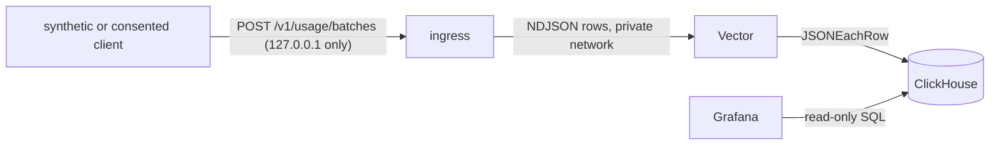

# Usage statistics reference stack

A local, open-source reference backend for Luxforge's optional usage statistics: the validating
[ingress](../usage-ingest/README.md) feeds [Vector](https://vector.dev), which writes to
[ClickHouse](https://clickhouse.com), which a private [Grafana](https://grafana.com) reads. It
implements the [open-source backend reference](../../docs/design/usage-statistics.md#open-source-backend-reference)
of the design: one row per event, one profile per session, 90-day expiry, no connection metadata, and
provisioned dashboards.

It is a reference for running and testing the pipeline on one machine. **It is not a hosted service.**
Nothing here provisions, deploys or publishes anything. The hosted Cloudflare backend lives in
[Willyham/luxforge-backend](https://github.com/Willyham/luxforge-backend); [DEPLOYMENT.md](DEPLOYMENT.md)
describes its current contract, test-tenant relay and separate production activation checklist.



## Layout

| Path | Contents |
| --- | --- |
| `compose.yaml` | The four services, the four networks, limits and hardening |
| `compose.grafana-local.yaml` | Optional override that publishes Grafana on `127.0.0.1` (see below) |
| `.env.example` | The environment file to copy to `.env` (gitignored): passwords and the ingress port |
| `ingress/Dockerfile` | Builds `services/usage-ingest` from its locked sources onto a distroless runtime |
| `vector/vector.yaml` | The HTTP source, row routing and the two ClickHouse sinks |
| `clickhouse/` | `initdb/001-schema.sql` (tables and views), `config.d/privacy.xml`, `users.d/users.xml` |
| `grafana/` | `Dockerfile` (plugin baked in), `provisioning/`, and the five dashboards in `dashboards/` |
| `test.sh`, `tests/` | The stack test and the client test (below), with the stack test's synthetic scenario |
| `install-feeds.py` | The update store's installer: the publication key's forced command, which installs a deploy archive of the update feeds ([design](../../docs/design/auto-update.md#publishing-and-serving-the-feeds), [deployment](DEPLOYMENT.md#the-update-feed-route)) |
| `probe.sh`, `probe.py` | The synthetic reference-contract probe: generated data and local statuses/limits/replies; do not run against the hosted endpoint ([live test alternative](DEPLOYMENT.md#the-desktop-against-the-live-test-tenant)) |
| `scan-logs.py` | Searches captured logs or table dumps for given values and for any IP address literal ([hosted privacy checks](DEPLOYMENT.md#activation-checklist)) |
| `DEPLOYMENT.md` | The activation checklist for `api.luxforge.app` |
| `NOTICE.md` | Licences of every component, without any audit claim |

## Pinned components

| Component | Pin |
| --- | --- |
| Vector | `timberio/vector:0.59.0-alpine@sha256:0e36bc2a290039e9b6a5e92f04bd2f133223506f72d09682c1df16c015172b7a` |
| ClickHouse | `clickhouse/clickhouse-server:25.8.33.6@sha256:0152dd511befe6a2c2ef53e930726179669b08116da78500b37c51c96ff5ee77` (25.8 long-term support) |
| Grafana OSS | `grafana/grafana-oss:13.0.2@sha256:5dad0df181cb644a14e13617b913b261a54f7d4fd4510721dba420929f35bea2` |
| Grafana ClickHouse data source | `grafana-clickhouse-datasource` 4.22.1, archive SHA-256 `97aad641f62ee4694b54c5bc225e40bb3f6c18cb3d9bfeeef7507a287f2e5a56` (checked in `grafana/Dockerfile`; installed at build time, never at start) |
| Ingress build | `rust:1.94.0-bookworm@sha256:365468470075493dc4583f47387001854321c5a8583ea9604b297e67f01c5a4f`, run on `gcr.io/distroless/cc-debian12:nonroot@sha256:9dac0a79194e45a7da0158a9c6da57b217585af0786db3845d1f0ec1a0dd182f`, crates from `services/usage-ingest/Cargo.lock` (`--locked`) |

The digests are the multi-architecture index digests, so the same pin works on arm64 and amd64.
Raising a pin means changing the version and digest together (`docker buildx imagetools inspect IMAGE`
prints the digest) and rerunning `test.sh`.

## Run it

Requires Docker with the compose plugin. From this directory:

```sh
cp .env.example .env
# edit .env: replace every change-me-* value (for example with: openssl rand -hex 16)
docker compose up -d --build        # first build compiles the ingress; a few minutes
docker compose ps                   # the ingress is published on 127.0.0.1:8080 only
./probe.sh --check-id-limiter http://127.0.0.1:8080   # about 45 checks; TLS ones are skipped on loopback HTTP
```

Look at the data with the ClickHouse client inside its container (nothing else can reach ClickHouse):

```sh
docker compose exec clickhouse sh -c 'clickhouse-client -u luxforge_admin --password "$LUXFORGE_CLICKHOUSE_ADMIN_PASSWORD" \
  -q "SELECT name, count() FROM luxforge.events_unique GROUP BY name"'
```

Open Grafana. By default it is published nowhere. To view it from this machine only:

```sh
docker compose -f compose.yaml -f compose.grafana-local.yaml up -d
# http://127.0.0.1:3000, sign in with LUXFORGE_GRAFANA_ADMIN_USER / LUXFORGE_GRAFANA_ADMIN_PASSWORD
```

Publishing a port needs a network with a route out, so this override gives the Grafana container one.
Its telemetry, update checks and plugin downloads stay off, but it is not isolated: do not use
the override on a server (use an SSH tunnel or a private reverse proxy that logs no client addresses).

Stop and delete everything, including the stored rows:

```sh
docker compose down --volumes
```

The ingress also serves the update feeds from the update store, `./update-store` unless `.env` sets
`LUXFORGE_UPDATE_STORE`, mounted read-only. Create the directory before starting the stack, so Docker
does not create it as root, and install a deploy archive into it (one that
`cargo xtask update-feed --deploy` wrote, or an **Update feeds** run's `update-feeds` artifact):

```sh
mkdir -p update-store
python3 -I install-feeds.py update-store < luxforge-update-feeds.tar
curl -sS -D - http://127.0.0.1:8080/v1/updates/linux-x86_64/appcast.xml
```

`down` without `--volumes` keeps the `clickhouse-data` volume, so rows survive a restart until their
90 days pass. Grafana keeps nothing: its dashboards are provisioned from `grafana/dashboards/`
and edits made in its UI are not persisted. ClickHouse applies `initdb/001-schema.sql` at every start;
every statement is idempotent and never drops or rewrites rows, so a changed table needs an explicit
`ALTER`.

## What is stored

Only what the ingress forwards after validating a batch ([row schema](../usage-ingest/README.md#rows)):

| Table | Holds | Key and deduplication |
| --- | --- | --- |
| `events` | one row per event: `received_at` (to the second), installation ID, session ID, `session_start`, `batch_seq`, `seq`, `t`, `name`, `release` and the event's registry fields | `ReplacingMergeTree`, ordered by `(session_id, seq)`: a batch delivered twice collapses to one row |
| `profiles` | one row per session: release and the device profile, replaced by a later batch's (higher `batch_seq`) | `ReplacingMergeTree(batch_seq)`, ordered by `session_id` |
| `batches` | per batch: installation ID, session ID, `batch_seq`, `dropped`, `received_at`, nothing else | ordered by `(session_id, batch_seq)` |
| `profile_batches` | Vector's landing table for profile rows; **stores nothing** (`Null` engine) and feeds `profiles` and `batches` | |

All three stores expire 90 days after `received_at` (`TTL ... DELETE`), and a merge removes expired
rows at least hourly; rows already older than 90 days are removed as they are inserted. There is no
raw body, header, address, request identifier, photo attribute, filename or additional key, no
device inventory beyond the per-session profile, and no table other than these.

Dashboards read views, never the tables: `events_unique` and `batches_unique` (deduplicated with
`FINAL`, and hiding anything past 90 days even before a merge removes it), `session_profiles` (the
latest profile with its cohort labels), `event_timeline` (readable labels, wall-clock time
`session_start + t`, and `missing_before`: how many events with lower `seq` are absent just before
each event), `session_active_time` and `session_summary` (events, gaps, batches, reported drops,
active time and cohort per session).

*Active time* walks a session's `app.presented` and `app.idle` events in `seq` order. A session
starts visible and active; time counts while it is visible and not idle, from the last state event
to the last event of any kind that was received. Time after the last received event is unknown and
not counted.

Percentiles use `quantileExactInclusive` over the individual event rows of each cohort (interpolating
between closest ranks). Per-batch percentiles are never averaged.

## Dashboards

Provisioned read-only from `grafana/dashboards/`, each opening with a panel that states the
opt-in bias, best-effort loss, the unseen end of every session, and that sessions and installations
are neither people nor physical devices:

| Dashboard | Shows |
| --- | --- |
| Luxforge usage | sessions and installations reporting, events, known gaps and reported drops, images added and exported, active time, feature and tool use, operation outcomes with durations, release and OS mix |
| Luxforge timing and resources by cohort | preview and operation duration percentiles and CPU, memory and GPU percentiles, grouped by app, OS, CPU, GPU, memory band, renderer or architecture, with sample, session and installation counts |
| Luxforge paths | share of sessions that add images, then enter Develop, then complete an export; what immediately precedes a failed operation (and whether events were missing before it); what follows entering Develop |
| Luxforge session timeline | one session's events in order with wall time and gaps, its process samples, and its batches |
| Luxforge installation and image history | an installation's sessions, timing and operations, and one of its images across those sessions. Image IDs belong to one installation; there is no photo lookup or account join |

## Tests

```sh
services/usage-statistics/test.sh
```

It generates throwaway passwords and a free port, brings the stack up under a throwaway compose
project (building the images on the first run, a few minutes), runs `tests/stack_test.py`, and always
removes the project's containers, networks and volumes, reporting anything left over. It needs
Docker and `python3`, and runs the real containers; there is no mock. It checks:

- **Configuration**: only the ingress publishes a port, bound to `127.0.0.1`; the collector, store and dashboard
  networks are internal; every pulled image and base image is pinned by digest and the plugin by
  SHA-256; Vector has memory buffers only; the relays have read-only root filesystems, dropped
  capabilities and memory limits.
- **Ingestion**: synthetic batches for five sessions on four installations (macOS, Windows and Linux
  profiles, a GPU-less fallback) go through the real ingress; every stored event equals the sent one
  field by field; a batch delivered twice is stored once; a missing batch and three missing events
  appear as gaps; per-batch `dropped` counts are stored once.
- **Queries**: every dashboard panel query runs through Grafana's own query API, and the results for
  cohort counts, exact percentiles for every cohort dimension, active time, the add-images, Develop,
  export path, failure predecessors (including one after a gap), the S1 and S3 timelines, installation
  history and per-image history are compared with values computed independently in Python from the
  same synthetic batches (`tests/scenario.py`).
- **Retention**: rows older than 90 days are not kept; rows 89 days old are; a scratch copy of each
  table's DDL with a 10-second TTL is merged to prove expiry runs on the same engine; the read views
  filter at 90 days.
- **Probe**: `probe.py` runs against the real ingress and passes, its 12 events land in 3 sessions of one
  installation with the synthetic release, and the `ALTER` statements it prints remove them from all
  three tables.
- **Pressure**: with ClickHouse stopped a flood receives only `202` or `429`, nothing is written to
  disk, memory stays under its limit, Vector logs dropped events, and after the relays restart no
  row from the outage returns; after a short outage the replayed backlog never exceeds what was
  accepted or the ingress queue bound; with Vector stopped the ingress counts failed forwards and
  drops.
- **Authentication**: Grafana refuses every unauthenticated or wrongly authenticated API call and
  proxy-auth headers; ClickHouse has no default user and the writer and reader hold only insert and
  select rights on `luxforge`; the admin user is not usable over the network.
- **Privacy**: requests carry sentinel `X-Forwarded-For` and `X-Real-IP` addresses, a User-Agent, a
  cookie, a custom header and a rejected payload, and every container's captured log is searched for
  them, for every installation, session and image ID sent, for every password, for every network
  address Docker assigned (gateway included) and for any other IPv4 literal; the stored tables are
  searched for the sentinels too; no ClickHouse system log table (so no query log) exists.

A skipped or unavailable check is not a pass: if Docker is missing the script fails.

### The desktop against the stack

```sh
services/usage-statistics/test.sh --client NEW_DIR
```

The same throwaway stack, with the ingress's per-installation limit at one batch per 5 seconds, and the
real desktop as its client ([the backend journey](../../docs/design/usage-statistics.md#the-backend-journey)).
It builds the release editor and `luxforge-ctl` with `tools/cargo-cached` (from the repository root),
runs the xtask `usage-backend` smoke scenario into `NEW_DIR/smoke` with `LUXFORGE_USAGE_INGRESS`
naming the ingress (three hidden, background-only launches with isolated configurations, each test
receiver a relay that forwards the client's requests to the ingress byte for byte and records them in
`receiver.json`), and then `tests/client_test.py` checks, from what the client actually sent:

- **Storage**: every batch the ingress accepted is stored once as exactly its events, column by
  column, with one profile per session equal to the client's device context and one loss counter per
  batch; a batch whose reply was withheld is stored once and was never resent; nothing of the `429`
  or the misrouted `404` batch is stored.
- **Dashboards**: the session timeline shows the refused batch as a gap; the installation history
  shows the installation's two launches; the image history follows the photograph across them and
  shows nothing of the old image ID after an opt-out and opt-in.
- **Negative fixtures** built from the client's own batch and device fields (identifying,
  free-form or malformed additions, a raw content hash as image ID, broken limits) are refused, with
  nothing stored; every registry `feature` and `tool` is accepted and stored as sent, and the two
  `registry.json` copies are equal.
- **Retention**: the client's rows expire under the stores' own DDL with a 10-second TTL, and a copy
  received 91 days ago is not kept.
- **Privacy at every hop**: no container log, and no Docker Desktop host or VM log written during the
  run, holds the client's identifiers, image IDs, image keys or User-Agent; no container log holds the
  machine's host name, home path, file names, a password or an IP address; stored rows hold no key,
  name, path, User-Agent or address; the desktop's own logs and frames hold no identifier or key; no
  request body holds any of the machine's names. The captures are kept in `NEW_DIR/hops`, and
  `NEW_DIR/client-test.json` lists every check.

The scenario alone (`tools/cargo-cached xtask smoke --scenario usage-backend --output NEW_DIR`) checks
only the client's side, and only with `LUXFORGE_USAGE_INGRESS` naming a loopback ingress; it is in no
`verify` tier, so nothing ordinary needs Docker.

Three more tests need no Docker and run in seconds: `python3 -I tests/probe_test.py` runs the probe
against a fake ingress in this process (a good endpoint, where its desktop-shaped batch carries exactly
the desktop's header fields, and one each of a redirect, a leaked header, a long reply, a missing `405`,
a missing `413` and a missing limiter, which it must fail; TLS against a throwaway certificate when
`openssl` is present, reported as skipped when it is not; the refusal of the production domain) and
`python3 -I tests/scan_logs_test.py` tests `scan-logs.py`, and `python3 -I tests/install_feeds_test.py`
tests `install-feeds.py` (installation, the link swap and pruning, and every refusal leaving the store
unchanged).

### The desktop against the hosted backend

For the live test tenant, start `npm run relay` in the separate backend checkout, then run the
app's `usage-backend` scenario with `LUXFORGE_USAGE_INGRESS=http://127.0.0.1:8788` (origin only) and
`LUXFORGE_USAGE_BACKEND_PROFILE=live`. The relay adds exactly `?tenant=test`, keeping synthetic
batches out of production dashboards. The live profile expects acceptance within 10 batches/minute,
without forcing the reference stack's one-per-five-seconds 429. It checks the client/HTTP journey;
it does not run `tests/client_test.py` against the hosted stores. See the full
[commands and evidence scope](DEPLOYMENT.md#the-desktop-against-the-live-test-tenant).

## Privacy configuration, hop by hop

| Hop | Configuration |
| --- | --- |
| Ingress | Never reads a peer address; no header but `Content-Type` and `Content-Length`; logs only fixed messages and aggregate counters; the optional per-installation limiter is in memory only |
| Vector | The source captures no header or query parameter; log namespace on, so a row is exactly the JSON the ingress sent and the sink rejects unknown columns; the API, internal metrics, console and file sinks are off; warning-level logs show counts and component names only in the tests |
| ClickHouse | All system log tables removed (no query log), `log_queries` off, console logging at warning level, crash reports off, no `default` user |
| Grafana | Analytics, update and plugin checks, news and feedback links off; no anonymous access, sign-up, snapshots to external services, public dashboards or Gravatar; access (router) logging off and the request logger silenced; `/metrics` off; plugin downloads off |
| Docker | Container logs are `json-file`, capped at 3 files of 5 MB each |

## Reference deployment privacy requirements

These constraints describe this reference. The hosted Cloudflare contract is in
[DEPLOYMENT.md](DEPLOYMENT.md), including its transient IP-based WAF and different analytics retention.
A deployment of this reference must keep every one of these:

- Put TLS in front of the ingress with a reverse proxy or load balancer that records **no client
  addresses, headers, User-Agent, bodies or request IDs** (no access logs, or access logs with the
  address field removed), does not add `X-Forwarded-For`, `Forwarded`, `X-Real-IP` or cookies when it
  proxies, and applies no IP-based rate limit or analytics. Do not use a CDN or WAF that records
  client IPs by default. Source and destination addresses exist in packets and connection state; they
  must never reach a log, a table or an IP-keyed structure.
- Keep Vector, ClickHouse and Grafana on private networks and never publish them. Vector's source is
  unauthenticated by design and trusts its network; ClickHouse and Grafana are authenticated.
- Do not add a diagnostic that logs batch bodies, rejection reasons, installation, session or image
  IDs, or a ClickHouse system log table.
- Use strong, unique values for every password in `.env`, keep `.env` out of version control and
  images, and rotate them by changing `.env` and recreating the containers.
- Keep the 90-day expiry. Restoring a backup or snapshot must not bring back expired rows: this
  reference takes none.
- Real users' reports are never test fixtures.

## Operational limits

- **Best-effort.** A queue that is full refuses (`429`), a body that cannot be forwarded is dropped,
  and nothing is retried by the ingress or spooled to disk. The ingress queue (256 batches or 32 MiB)
  and Vector's buffers (1,024 event and 256 profile rows) are in memory and are lost on a restart.
  Delivery during a short ClickHouse outage replays that bounded backlog; a longer outage loses it.
- The ingress tries each body once over a kept-alive connection, so the first batch after Vector
  restarts can be lost on its stale connection.
- Vector retries a failing ClickHouse write three times within about four seconds and then drops the
  batch; a duplicate delivery after a timeout is possible and is removed by the `(session_id, seq)`
  deduplication.
- **One node, no replication, no backup, no high availability.** ClickHouse is capped at 1.5 GB
  server memory (2 GB container) and the relays are single processes with one forwarding worker.
  This is sized for reference and testing, not for a measured production load.
- The ingress is on the one network with a published port and therefore a route out. It makes no
  outbound connection of its own; the other services have none.
- The dashboards are for the owner. Sparse cohorts, timelines and device profiles do not make
  records anonymous, and installation IDs are shown to administrators who sign in.
- Docker-based tests on a Mac check function and privacy settings. They are not evidence of
  production throughput or of the separately deployed hosted backend.
